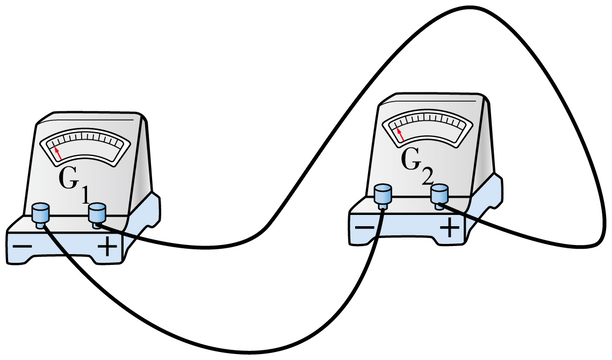

# Physics - 题目 2456

**ID**: ec00035e071f4f6d99233856e9398e4d
**年级**: Grade 11
**难度**: Easy
**题型**: Multiple-choice

## 题目
唐老师突发奇想，将实验室中相同灵敏电流计 ${\rm{G}}{{}_{1}}$ 和 ${\rm{G}}{{}_{2}}$ 的对应接线柱相连接。​​​​​​​‌将 ${\rm{G}}{{}_{1}}$ 表的指针从中间用力向左拨动，发生偏转，此时静止的 ${\rm{G}}{{}_{2}}$ 表指针偏转。对这一现象的分析正确的是（      ）

## 解答

1. 电流表主要部件是永久磁铁和带有线圈的指针，将 ${\rm{G}}{{}_{1}}$ 表的指针从中间用力向左拨动，发生偏转，相当于 ${\rm{G}}{{}_{1}}$ 表中线圈切割磁感线产生感应电流，即 ${\rm{G}}{{}_{1}}$ 表发生了电磁感应，产生的感应电流通过闭合回路流向 ${\rm{G}}{{}_{{{2}}}}$ ， ${\rm{G}}{{}_{{{2}}}}$ 中的通电线圈在磁场中受到安培力的作用发生转动，使得 ${\rm{G}}{{}_{{{2}}}}$ 表指针偏转。 ${\rm{G}}{{}_{1}}$ 表是“发电机”， ${\rm{G}}{{}_{{{2}}}}$ 表是“电动机”，同理，将 ${\rm{G}}{{}_{1}}$ 表的指针从中间向右拨动， ${\rm{G}}{{}_{2}}$ 表指针也会偏转。

## 知识点

**中文**:
  - 电磁感应现象中的能量转化及应用

**English**:
  - Energy Conversion in EM Induction

---
