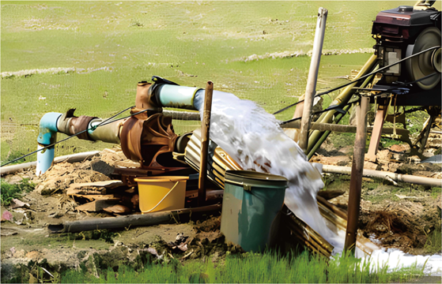

# Physics - 题目 248

**ID**: f382e13d77c9494dbe28e22b6e0dae5e
**年级**: Grade 11
**难度**: Easy
**题型**: Multiple-choice

## 题目
如图所示，干旱季节，农民通过潜水泵抽取地下水灌溉农田。​​​​​​​‌已知潜水泵由电动机、水泵输水钢管组成，某地下水源距离地表5.35m深，安装潜水泵时将一根输水钢管竖直打入地底下与地下水源连通，水泵出水口离地表高度为0.65m，水流由出水口水平喷出时的速度为4m/s，每秒出水量为4kg。已知电动机额定电压为220V，水泵的抽水效率为70%，水的密度为1.0×10^{3}kg/m^{3}，重力加速度g=10m/s^{2}，则（      ）

## 解答

1. A．出水口面积 $S=\frac {m}{ρv}=1\times 10{^{-3}}{\rm{m}}{^{2}}$ ，A错误；
2. B．每秒水流增加的机械能 $\Delta E=mg\left ({h{{}_{1}}+h{{}_{2}}}\right )+\frac {1}{2}mv{^{2}}=272{\rm{J}}$ ，B正确；
3. C．电动机的输入功率 $P{{}_{入}}=\frac {\Delta E}{η}=272\times \frac {10}{7}{\rm{W}}=388.6{\rm{W}}$ ，C错误；
4. D．电动机线圈的电流 $I=\frac {P{{}_{入}}}{U}=1.8{\rm{A}}$ ，D错误。选B。

## 知识点

**中文**:
  - 非纯电阻电路中的电功、电功率和电热

**English**:
  - Work, Power, and Heat in Non-Pure Resistive Circuits

---
