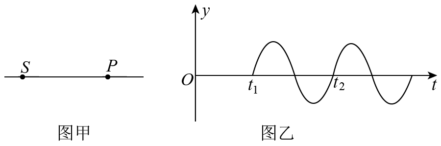

# Physics - 题目 1733

**ID**: f913b0d7f5454c67b99eccc328ea336c
**年级**: Grade 11
**难度**: Easy
**题型**: Multiple-choice

## 题目
如图甲所示，S为振源，P质点距S的距离为r，t=0时刻S由平衡位置开始振动，产生沿直线向右传播的简谐横波，图乙为P质点从t_{1}时刻开始振动的振动图像，则下列说法正确的是（      ）​​​​​​​‌

## 解答

1. A．P点的起振方向与O点起振方向相同，由乙图读出t_{1}时刻，P点的振动方向沿y轴正方向，即P点的起振方向沿y轴正方向，则t=0时刻，振源O振动的方向沿y轴正方向，A正确；
2. B．由图乙知，t_{2}时刻P点位于平衡位置，振动速度最大，方向沿y轴正方向，B错误；
3. C．根据图乙无法确定t_{2}时刻振源S的位置，C错误；
4. D．若波源停止振动，则P点不会马上停止振动，当波源停止前的振动形式传播到P后P才停止振动，D错误。
5. 故选A。

## 知识点

**中文**:
  - 简谐运动的函数与图像

**English**:
  - Functions and Graphs of SHM

---
