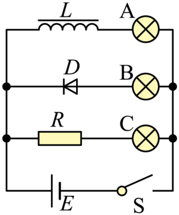

# Physics - 题目 1967

**ID**: 460f81be31174217ba3b795c8df2fd57
**年级**: Grade 11
**难度**: Easy
**题型**: Multiple-select

## 题目
如图所示的电路中，三个灯泡A、B、C完全相同，电感L的自感系数很大，其直流电阻与定值电阻R相等，D为理想二极管，下列判断中正确的是（      ）​​​​​​​‌

## 解答

1. 闭合开关S的瞬间，由于二极管的单向导电性，无电流通过B，所以B灯不亮；由于线圈中自感电动势的阻碍，A灯逐渐变亮。所以闭合开关S瞬间，只有灯泡C亮，A错误，B正确；闭合开关S稳定后，由于二极管的单向导电性，无电流通过B，B灯不亮；电感L的直流电阻与定值电阻R相等，AC一样亮。C错误；在电路稳定后，断开开关S的瞬间，L由于产生自感电动势，相当于电源，电流从右向左流过B，所以灯泡B要亮一下再熄灭。D正确。

## 知识点

**中文**:
  - 自感现象的理解与分析

**English**:
  - Understanding and Analysis of Self-Induction

---
