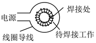

# Physics - 题目 2079

**ID**: 9ad3edc0113a40f28583cd4d1ae8222f
**年级**: Grade 11
**难度**: Easy
**题型**: Multiple-select

## 题目
高频焊接原理示意图，如图所示，线圈通以高频交流电，金属工件的焊缝中就产生大量焦耳热，将焊缝熔化焊接，要使焊接处产生的热量较大可采用（      ）​​​​​​​‌

## 解答

1. 当增大交变电流的电压，则线圈中交流电流增大，那么磁通量变化率增大，因此产生感应电动势增大，感应电流也增大，那么焊接时产生的热量也增大，故A正确；高频焊接利用高频交变电流产生高频交变磁场，在焊接的金属工件中就产生感应电流，根据法拉第电磁感应定律分析可知，电流变化的频率越高，磁通量变化频率越高，产生的感应电动势越大，感应电流越大，焊缝处的温度升高的越快，故B正确；增大电阻，在相同电流下，焊缝处热功率大，温度升的很高，故C正确，D错误．

## 知识点

**中文**:
  - 法拉第电磁感应定律

**English**:
  - Faraday's Law

---
