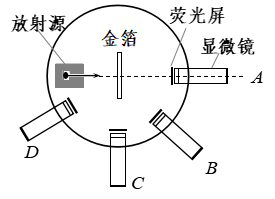

# Physics - 题目 2292

**ID**: a4b73bbd1d9c4b4fadc0acbf6662cd9f
**年级**: Grade 11
**难度**: Easy
**题型**: Multiple-select

## 题目
图为卢瑟福和他的同事们做的α粒子散射实验装置示意图，以下说法中正确的是​​​​​​​‌

## 解答

1. A项：α粒子散射实验中,选用金箔是因为金具有很好的延展性,可以做成很薄的箔，α粒子很容易穿过，还有其原子序数大， $α$ 粒子与金核间的库仑力大，发生偏转时明显，故A正确；
2. B项：大多数射线基本不偏折，少射线发生大角度的偏折，所以有α粒子进放C和D，故B错误；
3. C项：原子直径的数量级为 $10{^{-10}}{\rm{m}}$ ，原子核直径的数量级为： $10{^{-15}}{\rm{m}}$ ，所以原子的直径大小约为原子核的直径大小的10万倍，故C正确；
4. D项：实验装置一定要抽成真空，原因主要是由于 $α$ 粒子的电离作用，若在空气中由于电离 $α$ 粒子只能前进几厘米，故D错误．

## 知识点

**中文**:
  - 实验：α粒子散射实验

**English**:
  - Experiment: Alpha Particle Scattering

---
