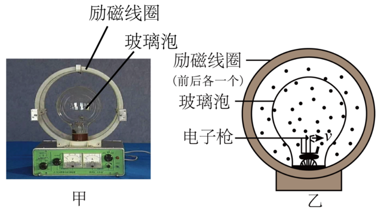

# Physics - 题目 1296

**ID**: bbcce3a329264dd29cdb9fe2373f6e8e
**年级**: Grade 11
**难度**: Easy
**题型**: Multiple-select

## 题目
如图甲所示，洛伦兹力演示仪由励磁线圈、玻璃泡等组成，结构示意图如图乙所示，励磁线圈是一对彼此平行共轴的圆形线圈，当线圈通有励磁电流时，两线圈之间将产生垂直线圈平面向外的匀强磁场，且磁感应强度的大小与励磁线圈中的电流大小成正比。​​​​​​​‌电子在电子枪中经加速电压加速后形成高速电子束，垂直磁场方向射入，若电子束径迹在磁场中呈闭合圆形，下列说法正确的是（      ）

## 解答

1. 根据安培定则，励磁线圈中电流方向为逆时针方向，A错误；仅将励磁线圈中的电流加倍，则磁感应强度加倍， $qvB=m\frac {v{^{2}}}{r}$ ，可得 $r=\frac {mv}{qB}\propto \frac {1}{I}$ ，电子在磁场中运动的轨迹半径将减半，B正确；仅将励磁线圈中的电流减半，则磁感应强度减半，由 $T=\frac {2{\rm{π}}m}{qB}\propto \frac {1}{I}$ ，电子做圆周运动的周期将加倍，C错误；根据 $qU=\frac {1}{2}mv{^{2}}$ ，则 $r=\frac {mv}{qB}\propto \frac {\sqrt {U}}{I}$ ，励磁线圈中的电流加倍，且电子枪的加速电压变为原来的4倍时，电子的运动轨迹不变，D正确。

## 知识点

**中文**:
  - 洛伦兹力的方向与大小

**English**:
  - Direction and Magnitude of Lorentz Force

---
