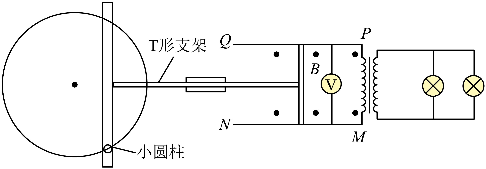

# Physics - 题目 917

**ID**: ef4ef77d821745a2bd04be806d245449
**年级**: Grade 11
**难度**: Easy
**题型**: Multiple-select

## 题目
小明同学设计了一个手动发电式电筒，装置简化如图。​​​​​​​‌装置左侧是一个半径为 $R=0.5{\rm{m}}$ 的水平圆盘，当圆盘绕轴心匀速转动时，固定在圆盘边缘处的小圆柱带动T形绝缘支架在水平方向往复运动，T形支架进而驱动导体棒在光滑的水平导轨上运动，导体棒运动的速度随时间变化的关系为 $v=\frac {\sqrt {2}}{2}\sin (\sqrt {2}t){\rm{m}}{\rm{/}}{\rm{s}}$ 。导轨间距 $d=1{\rm{m}}$ ，导轨间存在垂直平面向外的匀强磁场，磁感应强度 $B=2{\rm{T}}$ ，导轨右端连接一理想变压器，其输出端给两个额定电压为2V的灯泡供电，两灯泡刚好正常发光，线圈、导线及导轨电阻不计，电压表为理想电压表。下列说法正确的是（      ）

## 解答

1. 导体棒切割磁感线产生的感应电动势的瞬时值 $e=Bdv=2\times 1\times \frac {\sqrt {2}}{2}\sin \sqrt {2}t{\rm{V}}{\rm{=}}\sqrt {2}\sin \sqrt {2}t{\rm{V}}$ ，感应电动势的峰值为 $\sqrt {2}{\rm{V}}$ 。电压表示数为感应电动势的有效值 $U{{}_{{\rm{V}}}}=\frac {U{{}_{{\rm{m}}}}}{\sqrt {2}}=1{\rm{V}}$ ，电压表示数一直为 $1{\rm{V}}$ 不变，故A错误；变压器原线圈电压 $U{{}_{1}}=U{{}_{{\rm{V}}}}=1{\rm{V}}$ ，变压器副线圈电压 $U{{}_{1}}=2{\rm{V}}$ ，理想变压器的匝数比 $\frac {n{{}_{1}}}{n{{}_{2}}}=\frac {U{{}_{1}}}{U{{}_{2}}}=\frac {1}{2}$ ，故B正确；由速度公式可知，圆盘转动的角速度 $ω=\sqrt {2}{\rm{r}}{\rm{a}}{\rm{d}}{\rm{/}}{\rm{s}}$ ，故D正确；变压器输出电流的周期 $T=\frac {2π}{ω}=\frac {2π}{\sqrt {2}}{\rm{s}}{\rm{=}}\sqrt {2}π{\rm{s}}$ ，变压器输出电流的频率为 $f=\frac {1}{T}=\frac {1}{\sqrt {2}π}{\rm{H}}{\rm{z}}=\frac {\sqrt {2}}{2π}{\rm{H}}{\rm{z}}$ ，故C错误。

## 知识点

**中文**:
  - 理想变压器原、副线圈两端的电压、功率、电流关系及其应用

**English**:
  - Voltage, Power, Current Relations in Ideal Transformers

---
