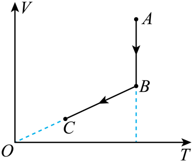

# Physics - 题目 2585

**ID**: fc4e64dcaccf45f9a7f2c2f84a4aba25
**年级**: Grade 11
**难度**: Easy
**题型**: Multiple-select

## 题目
质量一定的理想气体从状态A经过状态B变化到状态C，如图是该气体的 $V-T$ 图像。​​​​​​​‌下列说法正确的是（      ）

## 解答

1. AB：由题图可知，从A到B过程气体的体积减小，外界对气体做功，气体的温度不变，内能不变，根据热力学第一定律可知，气体放出热量，A正确，B错误；
2. C： $BC$ 的延长线过原点 $O$ ，则有 $\frac {V}{T}=C$  ，则可知B→C的过程中，气体发生的是等压变化，C正确；
3. D：从B到C的过程中，气体的温度降低，气体内能减少，D错误。选AC。

## 知识点

**中文**:
  - 气体的V-T（V-t）图像问题

**English**:
  - V-T (V-t) Graph Problems

---
