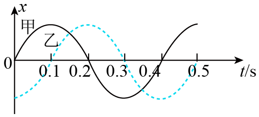

# Physics - 题目 1952

**ID**: 218b0c38047a4f058edfa19e0a2e6489
**年级**: Grade 11
**难度**: Easy
**题型**: 练习与应用

## 题目
下图是两个简谐运动的振动图像，它们的相位差是多少？​​​​​​​‌

## 解答

1. 根据图得知，甲乙的角速度相同，t=0时刻，甲图像的相位为0，乙图像的相位为 $-\frac {{\rm{π}}}{2}$ ，因此两个简谐运动的相位差为 $\Delta φ=-\frac {{\rm{π}}}{2}$

## 知识点

**中文**:
  - 振幅、周期、频率、相位和波长及其计算

**English**:
  - Calculation of Amplitude, Period, Frequency, Phase, and Wavelength

---
