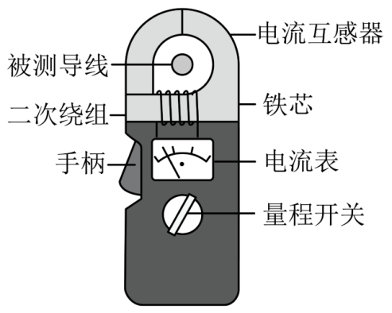

# Physics - 题目 566

**ID**: beecf14684924874b740e9bdc4cf345a
**年级**: Grade 11
**难度**: Easy
**题型**: 练习

## 题目
在某些需要带电工作的情况下测量交变电流时，电工需要使用钳形电流表，其结构如图所示，试说明钳形电流表测量交变电流大小的原理。​​​​​​​‌（提示：被测导线相当于变压器的初级线圈，二次绕组相当于变压器的次级线圈。）

## 解答

1. 钳形电流表实际上是升压变压器，其工作原理时电磁感应，由 $\frac {n{{}_{1}}}{n{{}_{2}}}=\frac {I{{}_{2}}}{I{{}_{1}}}$ ，可以求得待测交变电流的大小。

## 知识点

**中文**:
  - 变压器的构造和原理

**English**:
  - Construction and Principle of Transformers

---
