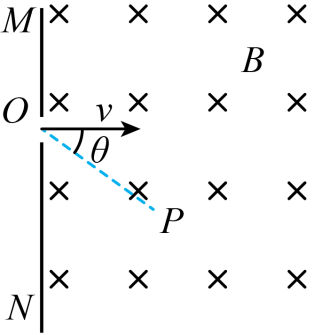

# Physics - 题目 1827

**ID**: e53dce8a01a446a881a417dcf7d8ce19
**年级**: Grade 11
**难度**: Easy
**题型**: .

## 题目
一个质量为m的负离子，电荷量大小为q，以速率v垂直于屏MN经过小孔O射入存在着匀强磁场的真空室中，如图所示。​​​​​​​‌磁感应强度B的方向与离的运动方向垂直，并垂直于纸面向里。（1）离子到达屏MN上时的位置与O点的距离；（2）如果离子进入磁场后经过时间t到达位置P，试求直线OP与离入射方向之间的夹角θ和t的关系式。

## 解答

1. （1）离子进入磁场后在洛伦兹力的作用下做匀速圆周运动，其轨迹如图所示
2. 
3. 由牛顿第二定律可得 $qvB=m\frac {v{^{2}}}{r}$ ，解得半径为 $r=\frac {mv}{qB}$ ，由几何关系可知，离子到达屏MN时的位置与O点的距离为 $d=2r=\frac {2mv}{qB}$
4. （2）离子做圆周运动的周期为 $T=\frac {2πr}{v}=\frac {2πm}{qB}$ ，由几何关系 $\angle OO{{}_{1}}P+\angle O{{}_{1}}PO+\angle O{{}_{1}}OP=π$ ， $\angle O{{}_{1}}PO=\angle O{{}_{1}}OP=\frac {π}{2}-θ$ ，联立可知，离子做圆周运动的圆心角 $\angle OO{{}_{1}}P=2θ$ ，离子由O运动到P的时间为 $t=\frac {\angle OO{{}_{1}}P}{2π}\cdot T$ ，联立知，θ和t的关系为 $θ=\frac {qBt}{2m}$

## 知识点

**中文**:
  - 带电粒子在有界磁场中运动的临界极值问题

**English**:
  - Critical Extremum Problems in Bounded Magnetic Fields

---
