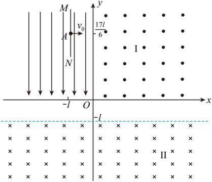

# Physics - 题目 2352

**ID**: 0554d558b3614eb2a6f119c578f5ac30
**年级**: Grade 11
**难度**: Hard
**题型**: Calculation

## 题目
如图所示，xOy平面内，第二象限存在沿y轴负方向的匀强电场，坐标为（-l， $\frac {17l}{6}$ ）的A点有一绝缘弹性竖直挡板MN；第一象限存在垂直平面向里的匀强磁场I；在y≤-l的区域存在垂直平面向里的匀强磁场II。​​​​​​​‌一电荷量为+q、质量为m的粒子，从A点沿x轴正方向以速度v_{0}射出。若粒子返回第二象限后与挡板MN碰撞，碰后电量不变，x方向速度变为等大反向，y方向速度不变。已知电场强度大小为 $\frac {mv{{}_{0}^{2}}}{3ql}$ ，不计粒子重力，不考虑边界效应。（1）求粒子第1次经过y轴的速度；（2）若粒子仅在匀强磁场I中运动1次就回到A点，求匀强磁场I的磁感应强度B_{1}；（3）若粒子第3次经y轴进入第一象限时，匀强磁场I的磁感应强度大小变为某一定值，方向变为垂直平面向外，随后粒子从O点进入第三象限之后不再进入电场，粒子运动过程中从x轴上方穿过F点，F点坐标为（8l，0），求匀强磁场II的磁感应强度B_{2}的最大值。

## 解答

1. （1）粒子在电场中做类平抛运动，沿x轴正方向有 $l=v{{}_{0}}t{{}_{1}}$
2. 解得 $t{{}_{1}}=\frac {l}{v{{}_{0}}}$
3. 沿y轴负方向有 $v{{}_{1}}=at{{}_{1}}=\frac {qE}{m}t{{}_{1}}=\frac {q}{m}·\frac {mv{{}_{0}^{2}}}{3ql}·\frac {l}{v{{}_{0}}}=\frac {v{{}_{0}}}{3}$ ， $y{{}_{1}}=\frac {1}{2}at{{}_{1}^{2}}=\frac {1}{2}·\frac {q}{m}·\frac {mv{{}_{0}^{2}}}{3ql}·(\frac {l}{v{{}_{0}}}){^{2}}=\frac {l}{6}$
4. 粒子第1次经过y轴的速度 $v^{′}{{{}_{1}}}=\sqrt {v{{}_{0}^{2}}+v{{}_{1}^{2}}}=\frac {\sqrt {10}}{3}v{{}_{0}}$
5. 设速度方向与x轴正方向的夹角为θ，则 ${\tan}θ=\frac {v{{}_{1}}}{v{{}_{0}}}=\frac {1}{3}$
6. （2）若粒子仅在匀强磁场 ${\rm{I}}$ 中运动1次就回到A点，则由几何关系可知 $2r{{}_{1}}{\cos}θ=y{{}_{1}}+y^{′}{{{}_{1}}}$ ， $y^{′}{{{}_{1}}}=v{{}_{1}}t{{}_{1}}+\frac {1}{2}at{{}_{1}^{2}}$
7. 粒子在磁场中做匀速圆周运动，则有 $qv^{′}{{{}_{1}}}B{{}_{1}}=m\frac {v^{′}{{{}_{1}^{2}}}}{r{{}_{1}}}$
8. 解得 $B{{}_{1}}=\frac {3mv{{}_{0}}}{ql}$
9. （3）粒子第二次回到A点时沿y轴负方向的速度大小为 $v{{}_{2}}=v{{}_{1}}+at{{}_{1}}=\frac {2}{3}v{{}_{0}}$
10. 从第二次回到A到第三次到达y轴沿y轴负方向的位移大小为 $y{{}_{3}}=v{{}_{2}}t{{}_{1}}+\frac {1}{2}at{{}_{1}^{2}}=\frac {5}{6}l$
11. 粒子第三次到达y轴沿y轴负方向的速度大小为 $v{{}_{3}}=v{{}_{1}}+2at{{}_{1}}=v{{}_{0}}$
12. 粒子第三次到达y轴速度大小为 $v=\sqrt {v{{}_{0}^{2}}+v{{}_{3}^{2}}}=\sqrt {2}v{{}_{0}}$
13. 设速度方向与x轴正方向的夹角为α，则 ${\tan}α=\frac {v{{}_{3}}}{v{{}_{0}}}=1$
14. 所以 $α=45{}\degree $
15. 粒子第三次到达y轴的位置距O点的距离为 $\frac {17}{6}l-y{{}_{3}}=2l$
16. 根据几何关系可得 $2R{{}_{1}}{\cos}α=2l$
17. 所以粒子在磁场I中做匀速圆周运动的半径为 $R{{}_{1}}=\sqrt {2}l$
18. 设粒子在磁场II中做匀速圆周运动的半径为R_{2}，粒子在I、II中运动的轨迹如图所示
19. 
20. 根据题意可知，粒子在磁场II中转过的圆心角为270°，离开磁场II再次进入磁场I转过的圆心角为270°后又会再次进入磁场II，以后循环下去，粒子在磁场II中做匀速圆周运动，有 $qvB{{}_{2}}=m\frac {v{^{2}}}{R{{}_{2}}}$
21. 当R_{2}取最小值时，B_{2}最大，粒子出电场后不再进入电场，则 $\frac {R{{}_{2}}}{{\cos}45{}\degree }-2\frac {l}{{\tan}45{}\degree }⩾R{{}_{1}}(1-{\cos}45{}\degree )$
22. 解得 $R{{}_{2}}⩾\frac {2+\sqrt {2}}{2}l$
23. 粒子由x轴上方经过F点，有 $n(\frac {R{{}_{2}}}{{\cos}45{}\degree }-2\frac {l}{{\tan}45{}\degree })+n\sqrt {2}R{{}_{1}}=8l$ （n=1，2，3……）
24. 解得 $R{{}_{2}}=\frac {4\sqrt {2}}{n}l$ （n=1，2，3……）
25. 可知，当n=3时，R_{2}取最小值，则 $R{{}_{2{\rm \min }}}=\frac {4\sqrt {2}}{3}l$
26. 根据 $qvB{{}_{2{\rm \max }}}=m\frac {v{^{2}}}{R{{}_{2{\rm \min }}}}$
27. 可得 $B{{}_{2{\rm \max }}}=\frac {3mv{{}_{0}}}{4ql}$ 。

## 知识点

**中文**:
  - 带电粒子在组合场中的运动

**English**:
  - Motion in Combined Fields

---
