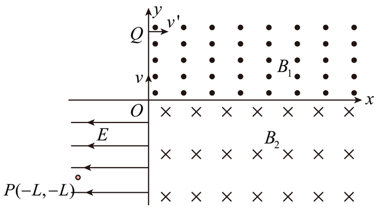

# Physics - 题目 2396

**ID**: 1b065778338d47f7ae0cc4a6c0f381bb
**年级**: Grade 11
**难度**: Hard
**题型**: Calculation

## 题目
某科研实验装置的电场和磁场分布的简化图如图所示。​​​​​​​‌第Ⅰ象限（包括y轴）充满垂直 $Oxy$ 平面向外、磁感应强度大小为 $B{{}_{1}}$ 的匀强磁场，第Ⅳ象限充满垂直 $Oxy$ 平面向里、磁感应强度大小 $B{{}_{2}}$ 的匀强磁场，第Ⅲ象限充满沿x轴负方向的匀强电场。在第Ⅲ象限内坐标为 $\left ({-L，-L}\right )$ 的粒子源P发射出质量为m、带电荷量为 $+q$ 的带电粒子甲，粒子甲经电场偏转后恰好从坐标原点O沿y轴正方向以速度v进入磁感应强度为 $B{{}_{1}}$ 的匀强磁场区域。已知 $B{{}_{1}}=B$ ， $B{{}_{2}}=2B$ 粒子重力不计。（1）求第Ⅲ象限内匀强电场的电场强度的大小E和粒子甲从粒子源射出时的速度大小 $v{{}_{0}}$ ；（2）从粒子甲由粒子源P射出开始计时，求粒子甲第三次穿过x轴的时间和此时穿过x轴的坐标；（3）若从y轴上点沿平行于x轴正方向以速度 $v\prime $ （ $v\prime $ 大小未知）发射与甲完全相同的粒子乙，且粒子乙第二次穿过x轴时与粒子甲第三次穿过x轴时的轨迹恰好相交，此时速度方向沿y轴正方向，求Q点在y轴上的位置坐标、粒子乙发射时的速度v大小以及粒子乙从Q点运动至该交点所用的时间。

## 解答

1. （1）由题意可知，粒子甲在电场和磁场中运动轨迹图如图（a）所示
2. 
3. 把粒子甲从P到O的运动逆向看做从O到P的类平抛运动，则有 $L=vt$ ， $L=\frac {1}{2}\frac {qE}{m}t{^{2}}$
4. 联立解得 $E=\frac {2mv{^{2}}}{qL}$
5. 设粒子甲从粒子源P射出时的速度大小为 $v{{}_{0}}$ ，由动能定理有 $-qEL=\frac {1}{2}mv{^{2}}-\frac {1}{2}mv{{}_{0}^{2}}$
6. 解得 $v{{}_{0}}=\sqrt {5}v$
7. （2）根据图（a）可知，粒子甲从P到坐标原点O的时间即为粒子第一次穿过x轴的时间 $t{{}_{1}}=\frac {L}{v}$
8. 设粒子甲在第Ⅰ象限的磁场区域中运动半径为 $r{{}_{甲1}}$ ，由牛顿第二定律有 $qvB{{}_{1}}=m\frac {v{^{2}}}{r{{}_{甲1}}}$
9. 根据题意有 $B{{}_{1}}=B$
10. 解得 $r{{}_{甲1}}=\frac {mv}{qB}$
11. 粒子甲在第Ⅰ象限运动的时间 $t{{}_{2}}=\frac {πr{{}_{甲1}}}{v}=\frac {πm}{qB}$
12. 粒子甲进入第Ⅳ象限，设其在第Ⅳ象限的磁场中运动半径为 $r{{}_{甲2}}$ ，则有 $qvB{{}_{2}}=m\frac {v{^{2}}}{r{{}_{甲2}}}$
13. 根据题意有 $B{{}_{2}}=2B$
14. 解得 $r{{}_{甲2}}=\frac {mv}{2qB}$
15. 粒子甲在第Ⅳ象限运动的时间 $t{{}_{3}}=\frac {πr{{}_{甲2}}}{v}=\frac {πm}{2qB}$
16. 粒子甲第三次穿过x轴的坐标 $x=2r{{}_{甲1}}+2r{{}_{甲2}}=\frac {3mv}{qB}$
17. 粒子甲从P发射到第三次穿过x轴的时间 $t{{}_{甲}}=t{{}_{1}}+t{{}_{2}}+t{{}_{3}}=\frac {L}{v}+\frac {3πm}{2qB}$
18. （3）设粒子乙发射时的速度为 $v^{′}$ ，运动轨迹如图（b）所示
19. 
20. 设粒子乙在第Ⅰ象限和第Ⅳ象限的磁场中运动半径分别为 $r{{}_{乙1}}$ 、 $r{{}_{乙2}}$ ，粒子在磁场中运动时，由洛伦兹力提供向心力，则有 $qvB=m\frac {v\prime {^{2}}}{r}$
21. 可得乙粒子在两个磁场中运动的轨迹半径为 $r{{}_{乙1}}=\frac {mv^{′}}{qB}$ ， $r{{}_{乙2}}=\frac {mv^{′}}{2qB}$
22. 根据题意有 $r{{}_{乙1}}+2r{{}_{乙2}}=2r{{}_{甲{{1}}}}+2r{{}_{甲2}}$
23. 联立解得粒子乙的发射速度 $v^{′}=\frac {3}{2}v$
24. Q点在y轴上的位置坐标 $y{{}_{Q}}=r{{}_{乙1}}=\frac {3mv}{2qB}$
25. 粒子乙从Q点运动至M点的时间 $t{{}_{乙}}=\frac {πr{{}_{乙1}}}{2v^{′}}+\frac {πr{{}_{乙2}}}{v^{′}}$
26. 解得 $t{{}_{乙}}=\frac {πm}{qB}$

## 知识点

**中文**:
  - 带电粒子在组合场中的运动

**English**:
  - Motion in Combined Fields

---
