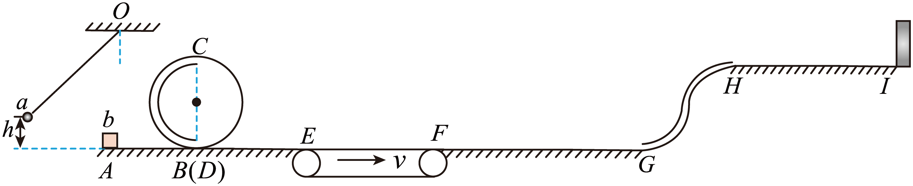

# Physics - 题目 2737

**ID**: 206a0aa81af04a5b91b27b67b7863cf4
**年级**: Grade 11
**难度**: Hard
**题型**: Calculation

## 题目
某物理兴趣小组受游乐园的“极速穿梭”过山车轨道启发，设计了一款游戏闯关装置。​​​​​​​‌如图所示，在竖直截面内，质量为m=0.1kg的小球a悬挂于O点，并向左拉开一定的高度h由静止下摆，悬点O正下方A点静置另一质量也为m的物块b，细绳始终张紧，小球摆到最低点与b发生弹性正碰，水平直轨道AG上有一半径为R=0.1m的光滑圆轨道BCD与其相切连接。圆轨道左侧是细管道，在底部B、D轨道错开，其右侧有长L=1.5m的水平传送带与直轨道无缝连接。两个相同的四分之一圆管道拼接成管道GH，圆管道半径为r=0.1m，其与直轨道HI相切于H点，直轨道HI右侧为弹性挡板，物块与其碰撞后能原速率反弹，游戏规定物块b能停在轨道HI上（不会再次通过管道回到FG上）为闯关成功。已知水平轨道FG=2DE=4AB=0.4m，HI长度为0.3m，物块与水平直轨道间的动摩擦因数均为µ_{1}=0.25，与传送带间的动摩擦因数为µ_{2}=0.5，其余轨道均光滑。（物块可视为质点，所有轨道平滑连接，不计空气阻力，g=10m/s^{2}）（1）若h=0.2m，求a、b碰后瞬间物块b的速度v_{0}的大小；（2）若物块b恰能通过圆轨道最高点C，求小球a释放的高度h_{1}；（3）若传送带以恒定速度v_{1}=3m/s顺时针转动，在（ $2$ ）条件下求物块b通过传送带的时间和系统摩擦产生的热量；（4）若小球a由高度h_{2}=0.3m处静止释放，且传送带以恒定线速度顺时针转动，要使游戏闯关成功，求传送带的速度v应满足的条件。

## 解答

1. （1）对小球a，根据机械能守恒定律可得 $mgh=\frac {1}{2}mv{{}_{a}^{2}}$ ，
2. 小球a与物块b碰撞过程满足 $mv{{}_{a}}=mv^{′}{{{}_{a}}}+mv{{}_{0}}$ ， $\frac {1}{2}mv{{}_{a}^{2}}=\frac {1}{2}mv^{′}{{{}_{a}^{2}}}+\frac {1}{2}mv{{}_{0}^{2}}$ ，
3. 联立解得 $v^{′}{{{}_{a}}}=0$ ， $v{{}_{0}}=v{{}_{a}}=2{\rm{m}}{\rm{/}}{\rm{s}}$ 。
4. （2）若物块b恰能通过圆轨道最高点C，则 $mg=m\frac {v{{}_{b}^{2}}}{R}$ ，
5. 对物块b，有 $-μ{{}_{1}}mg\cdot AB-mg\cdot 2R=\frac {1}{2}mv{{}_{b}^{2}}-\frac {1}{2}mv{{}_{b1}^{2}}$ ，
6. 小球a与物块b碰撞过程满足 $mv{{}_{a1}}=mv^{′}{{{}_{a1}}}+mv{{}_{b1}}$ ， $\frac {1}{2}mv{{}_{a1}^{2}}=\frac {1}{2}mv^{′}{{{}_{a1}^{2}}}+\frac {1}{2}mv{{}_{b1}^{2}}$ ，
7. 对小球a，有 $mgh{{}_{1}}=\frac {1}{2}mv{{}_{a1}^{2}}$ ，
8. 联立可得 $h{{}_{1}}=0.275{\rm{m}}$ 。
9. （3）物块从A运动到E，根据动能定理有 $-μ{{}_{1}}mg\cdot (AB+DE)=\frac {1}{2}mv{{}_{E}^{2}}-\frac {1}{2}mv{{}_{b1}^{2}}$ ，
10. 解得 $v{{}_{E}}=2{\rm{m}}{\rm{/}}{\rm{s}}$ ，
11. 由于 $x=\frac {v{{}_{1}^{2}}-v{{}_{E}^{2}}}{2μ{{}_{2}}g}=0.5{\rm{m}}<L$ ，
12. 说明物块先做匀加速直线运动，后做匀速直线运动，所以 $t=\frac {v{{}_{1}}-v{{}_{E}}}{μ{{}_{2}}g}+\frac {L-x}{v{{}_{1}}}=\frac {8}{15}{\rm{s}}$ ，
13. 系统摩擦产生的热量为 $Q=μ{{}_{2}}mg(v{{}_{1}}\cdot \frac {v{{}_{1}}-v{{}_{E}}}{μ{{}_{2}}g}-x)=0.05{\rm{J}}$ 。
14. （4）对小球a，有 $mgh{{}_{2}}=\frac {1}{2}mv{{}_{a2}^{2}}$ ，
15. 小球a与物块b碰撞过程满足 $mv{{}_{a2}}=mv^{′}{{{}_{a2}}}+mv{{}_{b2}}$ ， $\frac {1}{2}mv{{}_{a2}^{2}}=\frac {1}{2}mv^{′}{{{}_{a2}^{2}}}+\frac {1}{2}mv{{}_{b2}^{2}}$ ，
16. 对物块b，有 $-μ{{}_{1}}mg\cdot (AB+DE)=\frac {1}{2}mv{{}_{E1}^{2}}-\frac {1}{2}mv{{}_{b2}^{2}}$ ，
17. 联立解得 $v{{}_{E1}}=\sqrt {4.5}{\rm{m}}{\rm{/}}{\rm{s}}$ ，
18. 若滑块在HI上与弹性挡板碰撞后，恰好停在H点，则从F到停下由动能定理得 $-μ{{}_{1}}mg(FG+2HI)-mg\cdot 2r=0-\frac {1}{2}mv{{}_{F}^{2}}$ ，
19. 解得 $v{{}_{F}}=3{\rm{m}}{\rm{/}}{\rm{s}}>v{{}_{E1}}$ ，
20. 若滑块恰好停在I点，则从F到停下由动能定理得 $-μ{{}_{1}}mg(FG+HI)-mg\cdot 2r=0-\frac {1}{2}mv{{}_{F1}^{2}}$ ，
21. 解得 $v{{}_{F1}}=\sqrt {7.5}{\rm{m}}{\rm{/}}{\rm{s}}>v{{}_{E1}}$ ，
22. 则传送带的速度需满足的条件 $\sqrt {7.5}{\rm{m}}{\rm{/}}{\rm{s}}<v<3{\rm{m}}{\rm{/}}{\rm{s}}$ 。

## 知识点

**中文**:
  - 动量和能量的综合应用

**English**:
  - Integration of Momentum and Energy

---
