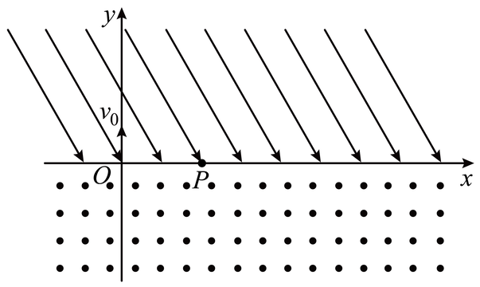

# Physics - 题目 1619

**ID**: 6b9628e43c0e463b84dd8d2b8b20cfa6
**年级**: Grade 11
**难度**: Hard
**题型**: Calculation

## 题目
如图所示， $xOy$ 平面内，在 $y>0$ 的区域存在匀强电场，电场强度大小为 $E$ ，方向与 $-y$ 方向夹角为 $37{^{\circ }}$ ；在 $x$ 轴下方存在匀强磁场，方向垂直于纸面向外。​​​​​​​‌一质量为 $m$ 、电荷量为 $q$ 的带正电的粒子以大小为 $v{{}_{0}}$ 的初速度从原点 $O$ 沿 $y$ 轴正方向射出，一段时间后粒子第一次从 $P$ 点进入磁场，在磁场中运动一段时间后回到原点 $O$ 再进入电场。不计粒子的重力，取 ${\rm{s}}{\rm{i}}{\rm{n}}37{^{\circ }}=0.6$ , ${\rm{c}}{\rm{o}}{\rm{s}}37{^{\circ }}=0.8$ 。（1）求粒子从 $O$ 到 $P$ 点的时间；（2）求磁感应强度 $B$ 的大小；（3）若在 $x$ 正半轴上另放置 $n$ 个质量也为 $m$ 的不带电微粒(按碰撞顺序标号依次为1、2、 $3\cdots n$ )，使带电粒子最初从 $O$ 点出发后每次从电场进入磁场时都恰好与一个不带电微粒发生正碰，碰后结合为一个整体，该整体仍可视为质点，且总质量与电荷量不变，不计重力。求第 $n$ 个微粒的位置坐标 $x{{}_{n}}$ 。

## 解答

1. （1）带电粒子在电场中运动时，则y方向有 $qE{{}_{y}}=qE{\rm{c}}{\rm{o}}{\rm{s}}37{}\degree =ma{{}_{y}}$ ，
2. 解得 $a{{}_{y}}=\frac {4qE}{5m}$ ，
3. 粒子经 $t{{}_{1}}$ 第一次到达P点，此时粒子在y方向上速度为 $-v{{}_{0}}$ ，则 $2v{{}_{0}}=a{{}_{y}}t{{}_{1}}$ ，
4. 联立解得 $t{{}_{1}}=\frac {5mv{{}_{0}}}{2qE}$ 。
5. （2）对粒子，x方向有 $qE{{}_{x}}=qE{\rm{s}}{\rm{i}}{\rm{n}}37{}\degree =ma{{}_{x}}$ ，
6. 解得 $a{{}_{x}}=\frac {3qE}{5m}$ ，
7. 由 $x{{}_{P}}=\frac {1}{2}a{{}_{x}}t{{}_{1}^{2}}$ ，
8. 联立解得 $x{{}_{P}}=\frac {15mv{{}_{0}^{2}}}{8qE}$ ，
9. 设粒子第一次经过 $P$ 点时速度大小为 $v{{}_{P}}$ ，方向与 $x$ 轴正向夹角为 $α$ ，由 $qv{{}_{{\rm{P}}}}B=m\frac {v{{}_{P}^{2}}}{r}$ ，
10. 解得第一次在磁场中圆周运动半径 $r=\frac {mv{{}_{P}}}{qB}$ ，
11. 半径在x轴方向的投影 $r{{}_{x}}=r{\rm{s}}{\rm{i}}{\rm{n}}α=\frac {mv{{}_{P}}·{\rm{s}}{\rm{i}}{\rm{n}}α}{qB}=\frac {mv{{}_{Py}}}{qB}=\frac {mv{{}_{{{0}}}}}{qB}$  ，
12. 由 $x{{}_{P}}=2r{{}_{x}}$      ，
13. 联立解得 $B=\frac {16E}{15v{{}_{0}}}$ 。
14. （3）如图所示
15. 
16. 每次碰后在磁场中偏转后回到电场，以及在电场中偏转后进行下一次碰前，过x轴时y方向速度大小不变，设第n次碰后y方向速度为 $v{{}_{(n+1)y}}$ ，则碰撞过程中，y方向动量守恒： $mv{{}_{0}}=2mv{{}_{2y}}=3mv{{}_{3{\rm{y}}}}=\cdots =(n+1)mv{{}_{(n+1)y}}$  ，
17. 第n次在磁场中圆周运动半径的x轴投影 $r{{}_{nx}}=\frac {(n+1)mv{{}_{{\rm{(}}n+1)y}}}{qB}=\frac {mv{{}_{0}}}{qB}$ ，
18. 即每次碰后，经磁场后都要向 $-x$ 方向返回 $Δx=x{{}_{P}}$  ，
19. 第n次在电场中运动时，在y方向做匀变速直线运动，则有 $2nmv{{}_{ny}}=qE{{}_{y}}t{{}_{n}}$ ，
20. 解得 $t{{}_{{\rm{n}}}}=\frac {2nmv{{}_{{\rm{n}}{\rm{y}}}}}{qE{{}_{{\rm{y}}}}}=\frac {2mv{{}_{{{0}}}}}{qE{{}_{{\rm{y}}}}}=t{{}_{1}}$  ，
21. 即每次在电场中偏转时间相同 $Δt=t{{}_{1}}=\frac {5mv{{}_{0}}}{2qE}$ ，
22. 第一次碰前x方向速度： $v{{}_{Px}}=\frac {qE{{}_{x}}}{m}Δt=\frac {3}{2}v{{}_{0}}$ ，
23. 与第①个静止微粒碰撞，x方向动量守恒有 $mv{{}_{Px}}=2mv{{}_{2x}}$ ，
24. 解得 $v{{}_{2x}}=\frac {1}{2}v{{}_{Px}}$ ，
25. 在磁场中偏转后回到电场时x方向速度仍为 $v{{}_{2x}}$ ，第二次碰前x方向速度 $v^{′}{{{}_{2x}}}=v{{}_{2x}}+\frac {qE{{}_{x}}}{2m}{\rm{Δ}}t=\frac {1}{2}v{{}_{Px}}+\frac {1}{2}v{{}_{Px}}=v{{}_{Px}}$ ，
26. 与第②个静止微粒碰撞，x方向动量守恒有 $2mv^{′}{{{}_{2x}}}=3mv{{}_{3x}}$ ，
27. 解得 $v{{}_{3x}}=\frac {2}{3}v^{′}{{{}_{2x}}}=\frac {2}{3}v{{}_{Px}}$ ，
28. 第三次碰前x方向速度 $v^{′}{{{}_{3x}}}=v{{}_{3x}}+\frac {qE{{}_{x}}}{3m}{\rm{Δ}}t=\frac {2}{3}v{{}_{Px}}+\frac {1}{3}v{{}_{Px}}=v{{}_{Px}}$ ，
29. 易知，第（n−1）次碰后x方向速度为 $v{{}_{nx}}=\frac {n-1}{n}v{{}_{Px}}=\frac {n-1}{n}\centerdot \\frac {3}{2}v{{}_{0}}$  ，
30. 第n次碰前x方向速度 $v^{′}{{{}_{nx}}}=v{{}_{Px}}=\frac {3}{2}v{{}_{0}}$ ，
31. 第（n−1）次碰后到第n次碰前，沿+x方向前进距离 ${\rm{Δ}}x{{}_{n}}=\frac {v{{}_{nx}}+v^{′}{{{}_{nx}}}}{2}{\rm{Δ}}t$ ，
32. 解得 ${\rm{Δ}}x{{}_{n}}=\left ({2-\frac {1}{n}}\right )x{{}_{P}}$ ，
33. 综上，第n个微粒的位置坐标 $x{{}_{n}}={\rm{Δ}}x{{}_{1}}+\left ({-x{{}_{P}}+{\rm{Δ}}x{{}_{2}}}\right )+\left ({-x{{}_{P}}+{\rm{Δ}}x{{}_{3}}}\right )+\cdots +\left ({-x{{}_{P}}+{\rm{Δ}}x{{}_{n}}}\right )$ ，
34. 联立可得 $x{{}_{n}}=（n+1）x{{}_{P}}-\left ({1+\frac {1}{2}+\frac {1}{3}+\cdots +\frac {1}{n}}\right )x{{}_{P}}$ 或 $x{{}_{n}}=nx{{}_{P}}-\left ({\frac {1}{2}+\frac {1}{3}+\cdots +\frac {1}{n}}\right )x{{}_{P}}$ ，
35. 解得 $x{{}_{n}}=（n+1）\frac {15mv{{}_{0}^{2}}}{8qE}-\left ({1+\frac {1}{2}+\frac {1}{3}+\cdots +\frac {1}{n}}\right )\frac {15mv{{}_{0}^{2}}}{8qE}$ 或 $x{{}_{n}}=n\frac {15mv{{}_{0}^{2}}}{8qE}-\left ({\frac {1}{2}+\frac {1}{3}+\cdots +\frac {1}{n}}\right )\frac {15mv{{}_{0}^{2}}}{8qE}$ 。

## 知识点

**中文**:
  - 动量守恒中的多次碰撞问题
  - 带电粒子在组合场中的运动

**English**:
  - Multiple Collisions in Momentum Conservation
  - Motion in Combined Fields

---
