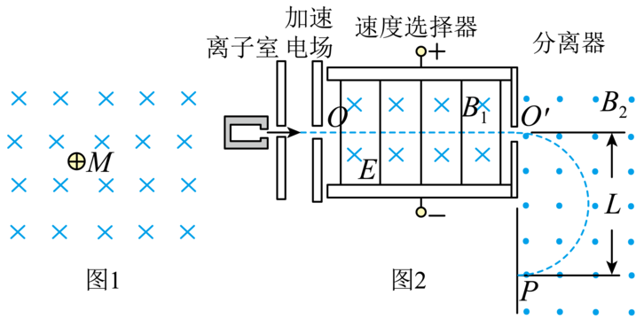

# Physics - 题目 1137

**ID**: b27ab96410ec40afb7d1784005eac40d
**年级**: Grade 11
**难度**: Hard
**题型**: Calculation

## 题目
根据牛顿力学经典理论，只要物体的初始条件和受力情况确定，就可以推知物体此后的运动情况。​​​​​​​‌情境1：如图1所示，空间存在水平方向的匀强磁场（垂直纸面向里），磁感应强度大小为 $B$ ，在磁场中 $M$ 点处有一质量为 $m$ 、电荷量为 $+q$ 的带电粒子。已知重力加速度 $g$ 。（1）若使带电粒子获得某一水平向右的初速度，恰好做匀速直线运动，求该速度的大小 $v{{}_{0}}$ ；（2）若在 $M$ 点静止释放该粒子，其运动将比较复杂。为了研究该粒子的运动，可以应用运动的合成与分解的方法，将它为零的初速度分解为大小相等的水平向左和水平向右的速度。求粒子运动过程中的最大速率 $v{{}_{{\rm{m}}}}$ 。（3）情境2：质谱仪由离子室、加速电场、速度选择器和分离器四部分组成，如图2所示。已知速度选择器的两极板间的电场强度为 $E$ ，磁感应强度大小为 $B{{}_{1}}$ ，方向垂直纸面向里，分离器中磁感应强度大小为 $B{{}_{2}}$ ，方向垂直纸面向外。某次实验离子室内充有某种带电离子，经加速电场加速后从速度选择器两极板间的中点 $O$ 平行于极板进入，部分离子通过小孔 $O^{′}$ 后进入分离器的偏转磁场中。打在感光区域 $P$ 点的离子，在速度选择器中沿直线运动，测得 $P$ 到 $O^{′}$ 点的距离为 $L$ 。不计离子的重力及离子间的相互作用，不计小孔 $O$ 、 $O^{′}$ 的孔径大小。当从 $O$ 点入射的离子速度满足 $\left ({\frac {E}{B{{}_{1}}}-{\rm{Δ}}v}\right )⩽v⩽\left ({\frac {E}{B{{}_{1}}}+{\rm{Δ}}v}\right )$ 时，在分离器的感光板上会形成有一定宽度的感光区域。求该感光区域的宽度 $D$ 。

## 解答

1. （1）粒子做匀速直线运动，受力平衡
2. $qv{{}_{0}}B=mg$
3. 得 $v{{}_{0}}=\frac {mg}{qB}$
4. （2）带电粒子由静止释放，其初速度可分解为相等的水平向左和水平向右的速度，设为 $v$ ，令 $v=\frac {mg}{qB}$ ，则带电粒子的运动可分解为沿水平方向的匀速直线运动和在竖直平面内的匀速圆周运动。两个运动合成，当速度方向相同时得最大值，有
5. $v{{}_{{\rm{m}}}}=2v=\frac {2mg}{qB}$
6. 情境2：
7. （3）离子在速度选择器中做匀速直线运动，有
8. $qvB{{}_{1}}=qE$
9. 离子在分离器中做匀速圆周运动，有
10. $qvB{{}_{2}}=m\frac {v{^{2}}}{r}$ ，且有 $r=\frac {L}{2}$
11. 解得 $\frac {q}{m}=\frac {2E}{B{{}_{1}}B{{}_{2}}L}$
12. 根据题意可知 $v{{}_{1}}=\frac {E}{B{{}_{1}}}+{\rm{Δ}}v$ 、 $v{{}_{2}}=\frac {E}{B{{}_{1}}}-{\rm{Δ}}v$ 的离子均能通过 ${\rm{D}}^{′}$ 孔进入分离器分别做匀速圆周运动，对应的半径分别设为 $r{{}_{1}}$ 、 $r{{}_{2}}$ ，有
13. $qv{{}_{1}}B{{}_{2}}=m\frac {v{{}_{1}^{2}}}{r{{}_{1}}}$
14. $qv{{}_{2}}B{{}_{2}}=m\frac {v{{}_{2}^{2}}}{r{{}_{2}}}$
15. $D=2\left ({r{{}_{1}}-r{{}_{2}}}\right )=\frac {4m{\rm{Δ}}v}{qB{{}_{2}}}$
16. 得 $D=\frac {2B{{}_{1}}L{\rm{Δ}}v}{E}$

## 知识点

**中文**:
  - 速度选择器

**English**:
  - Velocity Selector

---
