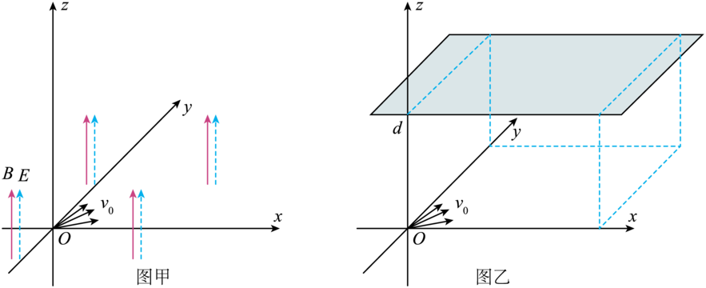

# Physics - 题目 2034

**ID**: ef9e81e9bed24198a656139ee51238eb
**年级**: Grade 11
**难度**: Hard
**题型**: Comprehensive

## 题目
如图甲所示，在直角坐标系Oxyz整个空间中，有沿 $+z$ 方向的匀强电场E和匀强磁场B，坐标原点O处有一粒子源，能不断向xOy平面第一象限内各个方向均匀发射粒子，粒子的质量为m、电荷量为q（q>0），初速度大小均为 $v{{}_{0}}$ ，不计粒子的重力及粒子间相互作用。​​​​​​​‌（1）若 $B=0，E=\frac {2mv{{}_{0}^{2}}}{dq}$ ，求初速度沿 $+y$ 方向的粒子运动到 $z=+d$ 平面时的y坐标；（2）若 $E=0，B=\frac {mv{{}_{0}}}{dq}$ ，经过足够长的时间，求所有粒子在xOy平面内经过区域的总面积 $S；$（3）若 $E=\frac {2mv{{}_{0}^{2}}}{dq}，B=\frac {2πmv{{}_{0}}}{3dq}$ ，在 $z=+d，y>0$ 的空间内有一足够大荧光屏，如图乙所示，求粒子打在荧光屏上形成亮线的长度 $L。$

## 解答

1. （1）粒子在yOz平面做类平抛运动
2. 设粒子运动的加速度为a，则有 $qE=ma$
3. y方向有 $y=v{{}_{0}}t{{}_{1}}$
4. z方向有 $d=\frac {1}{2}at{{}_{1}^{2}}$
5. 解得 $y=d$
6. （2）粒子在xOy平面内做匀速圆周运动
7. 由牛顿第二定律，有 $qv{{}_{0}}B=m\frac {v{{}_{0}^{2}}}{r{{}_{1}}}$
8. 解得 $r{{}_{1}}=d$
9. 经过足够长的时间，所有粒子在xOy平面内经过区域如图所示
10. 
11. 则其总面积为 $S=πr{{}_{1}^{2}}+\frac {1}{4}π（2r{{}_{1}}）{^{2}}$
12. 解得 $S=2πd{^{2}}$
13. （3）设粒子在磁场中运动的半径为r，粒子在磁场中的偏转角为 $θ$
14. 粒子的运动可以分解为平行xOy平面的匀速圆周运动，和沿 $+z$ 方向的匀加速直线运动，则有 $qv{{}_{0}}B=m\frac {v{{}_{0}^{2}}}{r}$
15. 解得 $r=\frac {3d}{2π}$
16. 粒子沿 $+z$ 方向的匀加速直线运动有 $d=\frac {1}{2}at{{}_{1}^{2}}$ ， $t{{}_{1}}=\frac {d}{v{{}_{0}}}$
17. 粒子在磁场中运动的周期 $T=\frac {2πr}{v{{}_{0}}}=\frac {3d}{v{{}_{0}}}$
18. 粒子在磁场中的偏转角为 $θ=\frac {2π}{T}t{{}_{1}}$
19. 解得 $θ=\frac {2π}{3}$
20. 入射的粒子在xOy平面内投影运动的轨迹如图
21. 
22. 由几何关系 $L=（\frac {π-θ}{2}）\times 2r{\rm{s}}{\rm{i}}{\rm{n}}（\frac {θ}{2}）$
23. 解得 $L=\frac {\sqrt {3}}{4}d$

## 知识点

**中文**:
  - 带电粒子在叠加场中的运动

**English**:
  - Motion in Superimposed Fields

---
