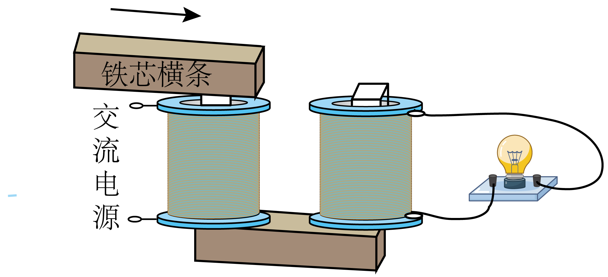

# Physics - 题目 2815

**ID**: f50d633413cd40c1a31bf8ab2b08f8d4
**年级**: Grade 11
**难度**: Hard
**题型**: Experiment

## 题目
某同学用可拆变压器探究“变压器原、副线圈电压与匝数的关系”。​​​​​​​‌（1）该同学将原线圈接一学生电源的交流电压输出端，并使用交流电压表分别测量原、副线圈两端的电压，得到的实验数据如下表所示。实验序号原线圈匝数$n{{}_{1}}$副线圈匝数$n{{}_{2}}$原线圈电压 $U{{}_{1}}$（V）副线圈电压 $U{{}_{2}}$（V）14002004.222.1024008004.228.36340016004.2216.83根据实验数据，得到的结论为：在误差允许的范围内，。（2）该同学利用（1）问中第2组数据时的副线圈给一标有“3.8V ； 0.3A”字样的小灯泡供电，发现小灯泡并没有被烧坏。测量此时小灯泡两端的电压约为3.00V，并不是8.36V，其原因主要是。（3）可拆变压器铁芯是由相互绝缘的薄硅钢片叠压而成。如图所示，原线圈接交流电源，副线圈接入小灯泡。第一次，缓缓移动铁芯横条使铁芯完全闭合；第二次，另取一块与变压器铁芯横条尺寸相同的普通铁块替换铁芯横条，重复上述实验。两次均观察到小灯泡由暗变亮。以下说法正确的是。

## 解答

1. （1） 根据实验数据，得到的结论为： 在误差允许范围内，变压器原、副线圈的电压比等于匝数比。
2. （2）副线圈有电阻，副线圈有内压。
3. （3）铁芯横条与普通铁块都是导磁材料，铁芯闭合后，减小了漏磁现象，产生的感应电动势增大，小灯泡变亮；变压器铁芯是利用由相互绝缘的薄硅钢片平行叠压而成的，而不是采用一整块硅钢，这样设计的原因是减小涡流，提高变压器的效率，用普通铁块和用铁芯横条相比，普通铁块由于涡流更容易发热，变压器效率低一些，第一次实验中小灯泡更亮些，A错误，B正确；无论用普通铁块还是用铁芯横条，副线圈中还是交变电流，流经小灯泡的电流均为交变电流，C正确。
4. （4）在原、副线圈匝数比一定的情况下，R增大，副线圈电流I_{2}减小，设原线圈电流为I_{1}，根据 $I{{}_{1}}n{{}_{2}}=I{{}_{2}}n{{}_{1}}$ ，知流经原线圈的电流I_{1}减小。把变压器和R等效为一个电阻 $R{^{^{′}}}{\rm ，\mathit{R}_{0}}$ 当作电源内阻，则输出功率 $P={\left({\frac {U{{}_{0}}}{R^{′}+R{{}_{0}}}}\right)^{2}}R^{′}=\frac {U{{}_{0}}{^{2}}}{R^{′}+\frac {R{{}_{0}}{^{2}}}{R^{′}}+2R{{}_{0}}}$ ，当内外电阻相等即 $R{{}_{0}}=R{^{^{′}}}$ ，时，输出功率最大，根据 $\frac {U{{}_{1}}}{U{{}_{2}}}=\frac {n{{}_{1}}}{n{{}_{2}}}$ ，得 $\frac {I{{}_{1}}R{^{^{′}}}}{I{{}_{2}}R}=\frac {n{{}_{1}}}{n{{}_{2}}}$ ，代入 $I{{}_{1}}n{{}_{1}}=I{{}_{2}}n{{}_{2}}$ ，解得 $R={\left({\frac {n{{}_{2}}}{n{{}_{1}}}}\right)^{2}}R^{′}={\left({\frac {n{{}_{2}}}{n{{}_{1}}}}\right)^{2}}R{{}_{0}}$ 。

## 知识点

**中文**:
  - 变压器的构造和原理
  - 理想变压器原、副线圈两端的电压、功率、电流关系及其应用

**English**:
  - Construction and Principle of Transformers
  - Voltage, Power, Current Relations in Ideal Transformers

---
