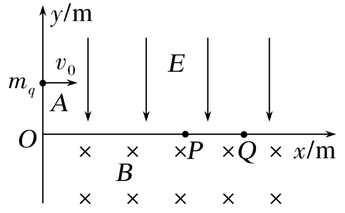

# Physics - 题目 1815

**ID**: e3b68534a05a49999ec66179657eb3bb
**年级**: Grade 11
**难度**: Medium
**题型**: 基础练

## 题目
如图所示，在直角坐标系xOy的第一象限中分布着沿y轴负方向的匀强电场，在第四象限中分布着方向垂直于纸面向里的匀强磁场。​​​​​​​‌一个质量为m、电荷量为＋q(q>0)的微粒，在A点(0，3 m)以初速度v_{0}＝120 m/s平行x轴正方向射入电场区域，然后从电场区域进入磁场，又从磁场进入电场，并且先后只通过x轴上的P点(6 m，0)和Q点(8 m，0)各一次。已知该微粒的比荷为 $\frac{q}{m}{\rm ＝10^{2}}$  C/kg，微粒重力不计。(1)求微粒从A到P所经历的时间和加速度的大小；(2)求出微粒到达P点时速度方向与x轴正方向的夹角，并画出带电微粒在电场和磁场中由A至Q的运动轨迹；(3)求电场强度E和磁感应强度B的大小。

## 解答

1. (1)微粒平行x轴正方向射入电场区域，由A到P做类平抛运动，微粒在x轴正方向做匀速直线运动，由x＝v_{0}t得 ${\rm \mathit{t}＝}\frac{x}{{v}_{0}}{\rm ＝0.05}$  s，微粒沿y轴负方向做初速度为零的匀加速直线运动，由 ${\rm \mathit{y}＝}\frac{1}{2}{\rm \mathit{at}^{2}}$ ，其中y＝3 m得a＝2.4×10^{3}m/s^{2}。
2. (2)v_{y}＝at，则tan  ${\rm \mathit{α}＝}\frac{{v}_{y}}{{v}_{0}}{\rm ＝1}$ ，所以α＝45°，轨迹如图所示，
3. 
4. (3)由qE＝ma，得E＝24 N/C，设微粒从P点进入磁场做匀速圆周运动的速度为v，则 ${\rm \mathit{v}＝}\sqrt{2}{\rm \mathit{v}_{0}＝120}$  $\sqrt{2}$  m/s，由几何关系可知 ${\rm \mathit{r}＝}\sqrt{2}$  m，由 ${\rm \mathit{qvB}＝\mathit{m}}\frac{{v}^{2}}{r}$ 得 ${\rm \mathit{B}＝}\frac{mv}{qr}{\rm ＝1.2}$  T。

## 知识点

**中文**:
  - 带电粒子在组合场中的运动

**English**:
  - Motion in Combined Fields

---
