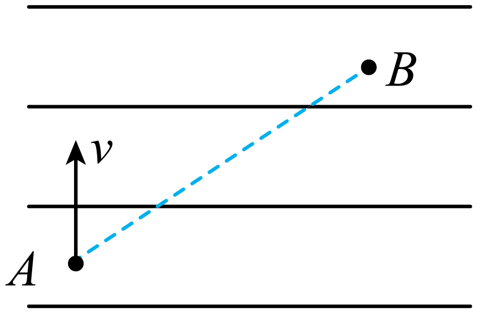

# Physics - 题目 709

**ID**: 024018efc0f64ba6aadbebf65456c51e
**年级**: Grade 11
**难度**: Medium
**题型**: Calculation

## 题目
质量为m，带电量为-q的微粒（重力不计），经过匀强电场中的A点时速度为v，方向与电场线垂直，运动到B点时速度大小为2v，如下图所示．已知A、B两点间的距离为d．求：(1).​​​​​​​‌A、B两点的电势差；(2).电场强度的大小和方向．

## 解答

1. （1）根据动能定理可得：（3分）解得：
2. （2）由题意可知，带电微粒在电场中做类平抛运动，垂直电场方向上做匀速运动，y="vt"，沿电场方向做初速度为零的匀加速运动，，又x^{2}+y^{2}=d^{2}^{，}v^{2}+(at)^{2}=(2v)^{2}，解得：，方向向左

## 知识点

**中文**:
  - 匀强电场中电势差与电场强度的关系
  - 电势能与静电力做功
  - 带电粒子（物体）在重力场和电场组成的复合场中的运动

**English**:
  - U=Ed in Uniform Electric Field
  - Electric Potential Energy and Work Done by Electrostatic Force
  - Motion in Gravity and Electric Composite Fields

---
