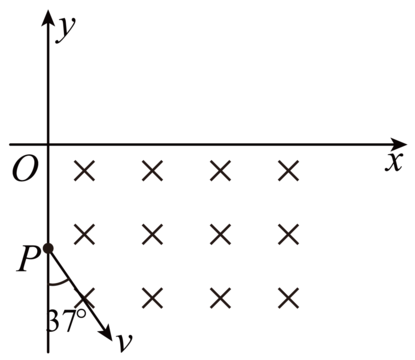

# Physics - 题目 1773

**ID**: 6511f4a5ce3240f1854e51c58e8a2d01
**年级**: Grade 11
**难度**: Medium
**题型**: Calculation

## 题目
如图所示，在平面直角坐标系xOy的第四象限有垂直于纸面向里的匀强磁场，一质量为 $m=5.0\times 10{^{-8}}$ kg、电何量为 $q=1.0\times 10{^{-6}}$ C的带电粒子，从静止开始经U=10V的电压加速后，从P点沿图示方向进入磁场，已知OP=30cm（粒子重力不计，sin37°=0. 6，cos37°=0. 8）。​​​​​​​‌(1)求粒子到达P点时速度v的大小；(2)若粒子恰好不能进入x轴上方，求磁感应强度B的大小；(3)若磁感应强度B′=2. 0T，粒子从x轴上的Q点离开磁场，求OQ的距离。

## 解答

1. (1)对粒子的加速过程，由动能定理：
2. $qU=\frac {1}{2}mv{^{2}}$
3. 代入数据得：
4. v=20m/s；
5. (2)粒子恰好不从x轴上方射出的运动轨迹如图甲所示，
6. 
7. 由几何关系得：
8. $OP=R+R{\cos}53^\circ $
9. 由牛顿第二定律得：
10. $qvB=\frac {mv{^{2}}}{R}$
11. 得：
12. $R=\frac {mv}{qB}$
13. 解得：
14. $B=\frac {16}{3}{\rm{T}}$ ；
15. (3)粒子仅在洛伦兹力作用下做匀速圆周运动，有：
16. $R^{′}=\frac {mv}{qB^{′}}$
17. 代入数据得：
18. $R^{′}=0.50$ m
19. 而：
20. $\frac {OP}{{\cos}53^\circ }=0.50{\rm{m}}$
21. 故圆心一定在x轴上，粒子运动轨迹如图乙所示
22. 
23. 由几何关系可知：
24. $OQ=R^{′}+R^{′}{{\rm s}}{\rm in}53^\circ $
25. 解得：
26. OQ=0. 90m。

## 知识点

**中文**:
  - 带电粒子的运动半径和周期公式及其简单应用

**English**:
  - Radius and Period Formulas and Applications

---
