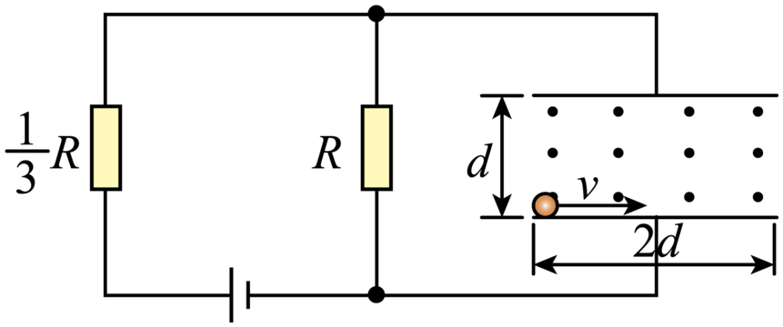

# Physics - 题目 2038

**ID**: 68d0c5a7bfa1486a847a99435fc9073d
**年级**: Grade 11
**难度**: Medium
**题型**: Calculation

## 题目
如图，两个定值电阻的阻值分别为R和 $\frac {1}{3}R$ ，直流电源的内阻为 $\frac {1}{6}R$ ，平行板电容器两极板水平放置，板间距离为d，极板长为 $2d$ ，极板间存在方向水平向外的匀强磁场，质量为m、带电量为 $-q$ 的小球以初速度v沿水平方向从电容器下板左侧边缘进入电容器，做匀速圆周运动，恰从电容器上板右侧边缘离开电容器。​​​​​​​‌此过程中，小球未与极板发生碰撞，重力加速度大小为g，忽略空气阻力。（1）求直流电源的电动势E的大小；（2）求磁场的磁感应强度B的大小。

## 解答

1. （1）小球在电磁场中做匀速圆周运动，则电场力与重力平衡，由此可得 $E{{}_{1}}q=mg$  $U=E{{}_{1}}d$ ，根据闭合欧姆定律可得 $U=\frac {ER}{R+\frac {1}{3}R+\frac {1}{6}R}$ ，联立解得 $E=\frac {3mgd}{2q}$
2. （2）设粒子在电磁场中做圆周运动的半径为 $r$ ，运动轨迹如图所示
3. 
4. 根据几何关系 ${\left({r-d}\right)^{2}}+{\left({2d}\right)^{2}}=r{^{2}}$ ，解得 $r=\frac {5}{2}d$ ，粒子受到的洛伦兹力提供向心力，则 $qvB=m\frac {v{^{2}}}{r}$ ，解得 $B=\frac {2mv}{5qd}$

## 知识点

**中文**:
  - 带电粒子在有界磁场中运动的临界极值问题

**English**:
  - Critical Extremum Problems in Bounded Magnetic Fields

---
