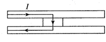

# Physics - 题目 2314

**ID**: 6a5604d4efaf468382cb2ea09f1de31f
**年级**: Grade 11
**难度**: Medium
**题型**: Calculation

## 题目
电磁轨道炮原理如图所示，炮弹（可视为长方形导体）置于两固定的平行轨道之间，并与轨道壁密接.​​​​​​​‌开始时炮弹在轨道的一端，通有电流后炮弹会被磁场力加速，最后从位于轨道另一端的出口高速射出.设两轨道之间的距离d=0.10 m，轨道长L=5.0 m，炮弹质量m=0.3 kg.轨道上的电流I的方向如图中箭头所示.可认为，炮弹在轨道内运动时，它所在处磁场的磁感应强度始终为B=2.0 T，方向垂直纸面向里.若炮弹在出口处速度为υ=2.0×10^{3}m／s，忽略摩擦力与重力的影响.求：（1）炮弹在轨道中运动的加速度大小；（2）通过轨道的电流I.

## 解答

1. 在轨道通有电流I时，炮弹作为导体受到磁场施加的安培力为F=IdB，
2. 设炮弹的加速度大小为a，则有F=ma，
3. 炮弹在两轨道间做匀加速运动，有v^{2}=2aL，
4. 联立解得a=4.0×10^{5}m/s^{2}，
5. I=6.0×10^{5}A.

## 知识点

**中文**:
  - 安培力的大小

**English**:
  - Magnitude of Ampere Force

---
