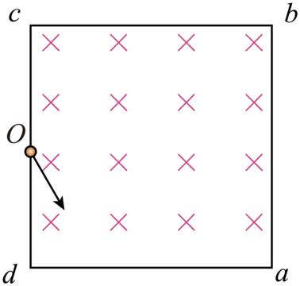

# Physics - 题目 1996

**ID**: 973bdf874e5e4ad28edb55bd43d8ecac
**年级**: Grade 11
**难度**: Medium
**题型**: Calculation

## 题目
如图所示某种质量为m，电荷量为q的带正电离子，从cd边的中点O沿纸面以与Od成30°角的方向射入边长为a的正方形abcd边界内的匀强磁场区域，已知匀强磁场的磁感应强度为B，方向垂直纸面向里，不计粒子的重力以及离子间的相互作用。​​​​​​​‌求：(1)若粒子速度为： $v=\frac {Bqa}{5m}$ ，离子在磁场中运动的时间t；(2)若要离子全部从ab边射出，粒子速度范围。

## 解答

1. （1）在磁场中做匀速圆周运动洛伦兹力提供向心力
2. $qvB=\frac {mv{^{2}}}{r}$
3. 以上各式联立代入数据解得
4. $r=\frac {a}{5}$
5. 如图所示
6. 
7. 当粒子轨迹与bc边界相切时，如图中③所示，设此时的轨道半径为 $r{{}_{3}}$ ，由几何关系得
8. $r{{}_{3}}+r{{}_{3}}{\rm{s}}{\rm{i}}{\rm{n}}{{3}}{{0}}{}\degree {\rm{=}}\frac {a}{2}$
9. 解得
10. $r{{}_{3}}=\frac {a}{3}$
11. 因为
12. $r<r{{}_{3}}$
13. 则粒子从cd边射出
14. 根据对称性得轨迹的圆心角为300°，运动时间为
15. $t=\frac {300{}\degree }{360{}\degree }T=\frac {5}{6}\times \frac {2πm}{qB}=\frac {5πm}{3qB}$
16. （2）当粒子不从ad边射出的临界轨迹是轨迹与ad边相切，如图中①所示，设此时粒子轨道半径为 $r{{}_{1}}$ ，几何关系得
17. $r{{}_{1}}-\frac {a}{2}=r{{}_{1}}{\rm{s}}{\rm{i}}{\rm{n}}{{3}}{{0}}{}\degree $
18. 解得
19. $r{{}_{1}}=a$
20. 在磁场中做匀速圆周运动洛伦兹力提供向心力
21. $qv{{}_{1}}B=\frac {mv{{}_{1}^{2}}}{r{{}_{1}}}$
22. 解得
23. $v{{}_{1}}=\frac {Bqa}{m}$
24. 当粒子恰好从ab边射出的临界轨迹是轨迹与ab边相切，如图中②所示，设此时粒子轨道半径为 $r{{}_{2}}$ ，由几何关系得
25. $r{{}_{2}}+r{{}_{2}}{\rm{c}}{\rm{o}}{\rm{s}}{{3}}{{0}}{}\degree {\rm{=}}a$
26. 解得
27. $r{{}_{2}}=\left ({4-2\sqrt {3}}\right )a$
28. 在磁场中做匀速圆周运动洛伦兹力提供向心力
29. $qv{{}_{2}}B=\frac {mv{{}_{2}^{2}}}{r{{}_{2}}}$
30. 解得
31. $v{{}_{2}}=\frac {Bqa\left ({4-2\sqrt {3}}\right )}{m}$
32. 要使粒子全部从ad边射出，速度需满足
33. $\frac {Bqa\left ({4-2\sqrt {3}}\right )}{m}<v<\frac {Bqa}{m}$

## 知识点

**中文**:
  - 带电粒子在有界磁场中运动的临界极值问题

**English**:
  - Critical Extremum Problems in Bounded Magnetic Fields

---
