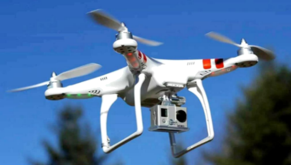

# Physics - 题目 2472

**ID**: 997d0f4e781649748b020e6752d29f51
**年级**: Grade 11
**难度**: Medium
**题型**: Calculation

## 题目
四旋翼小型多用途无人机能执行多项任务，并能够垂直起降。​​​​​​​‌如图，一架质量 $m=2{\rm{k}}{\rm{g}}$ 的无人机，其动力系统的最大升力 $F=36{\rm{N}}$ ，运动过程中所受阻力大小恒为 $f=4{\rm{N}}$ ， $g=10{\rm{m}}{\rm{/}}{\rm{s}}{^{2}}$ ，求：（1）无人机动力系统能提供竖直向上的最大飞行速度为24m/s，无人机从地面用最大升力由静止开始竖直上升96m所用的最短时间；（2）无人机悬停在距地面高度 $H=45{\rm{m}}$ 处突然关闭动力，竖直下落一段高度后，动力设备重新启动提供向上最大升力，为保证安全着地，飞行器从开始下落到恢复动力的最长时间t。

## 解答

1. （1）无人机以最大升力做匀加速直线运动再以最大速度匀速上升的时间最短，由牛顿第二定律，有 $F-mg-f=ma{{}_{1}}$
2. 到达最大速度 $v=a{{}_{1}}t{{}_{1}}$
3. 解得所需的时间 $t{{}_{1}}=4{\rm{s}}$
4. 上升高度 $h{{}_{1}}=\frac {1}{2}a{{}_{1}}t{{}_{1}}{^{2}}$
5. 解得 $h{{}_{1}}=48{\rm{m}}$
6. 匀速上升 $h-h{{}_{1}}=vt{{}_{2}}$
7. 解得 $t{{}_{2}}=2{\rm{s}}$
8. 最短时间 ${\rm{t}}{{}_{3}}={\rm{t}}{{}_{1}}+{\rm{t}}{{}_{2}}=6{\rm{s}}$
9. （2）下落过程中根据牛顿第二定律 $mg-f=ma{{}_{2}}$
10. 解得 $a{{}_{2}}=8{\rm{m}}{\rm{/}}{\rm{s}}{^{{{2}}}}$
11. 恢复升力后向下减速运动过程根据牛顿第二定律 $F-mg+f=ma{{}_{3}}$
12. 解得 $a{{}_{3}}=10{\rm{m}}{\rm{/}}{\rm{s}}{^{{{2}}}}$
13. 设恢复升力时的速度为 $v{{}_{{\rm{m}}}}$ ，则有 $\frac {v{{}_{{\rm{m}}}}{^{2}}}{2a{{}_{2}}}+\frac {v{{}_{{\rm{m}}}}{^{2}}}{2a{{}_{3}}}=H$
14. 解得 $v{{}_{{\rm{m}}}}={{2}}{{0}}{\rm{m}}{\rm{/}}{\rm{s}}$
15. 代入数据解得 $t{{}_{2}}=\frac {v{{}_{{\rm{m}}}}}{a{{}_{2}}}=2.5{\rm{s}}$

## 知识点

**中文**:
  - 两类动力学问题

**English**:
  - Two Types of Dynamics Problems

---
