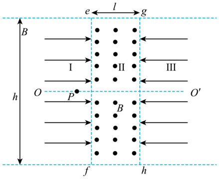

# Physics - 题目 1651

**ID**: a7beb775d73e4a37925b1d939a9ef640
**年级**: Grade 11
**难度**: Medium
**题型**: Calculation

## 题目
如图所示，三个矩形区域 ${\rm{I}}$ 、 ${\rm{I}}{\rm{I}}$ 、 ${\rm{I}}{\rm{I}}{\rm{I}}$ 中，分别存在有界的匀强电场或磁场， $OO^{′}$ 为水平中轴线，区域I、III中有大小相等、方向相反的匀强电场，电场强度大小未知，区域II中存在垂直纸面向外的匀强磁场，磁感应强度大小为 $B$ 。​​​​​​​‌在区域 ${\rm{I}}$ 的中线 $OO^{′}$ 上，将质量为 $m$ 、电荷量为 $q$ 的带正电粒子从距离边界线 $ef$ 为 $d$ 的 $P$ 点由静止释放，粒子恰好能够进入区域III运动。已知区域II的水平宽度为 $l$ ，区域I、III的水平宽度足够大，不考虑电场、磁场的边界效应，不计粒子所受的重力。(1)求匀强电场的电场强度大小 $E$ 的值；(2)若释放点 $P$ 到边界 $ef$ 的距离为 $4d$ ，求粒子前两次经过边界 $ef$ 的时间间隔 $t$ ；(3)若释放点 $P$ 到边界 $ef$ 的距离为 $4d$ ，且粒子恰能经过边界线端点 $f$ 点，求区域I的竖直高度 $h$ 。

## 解答

1. （1）根据牛顿第二定律可得 $qE=ma$
2. 设粒子在磁场中做圆周运动的速度大小为 $v$ ，根据运动学公式可得 $v{^{2}}=2ad$
3. 粒子在磁场中运动时，根据洛伦兹力提供向心力可得 $qvB=m\frac {v{^{2}}}{r}$
4. 粒子恰好能够进入区域III时，在磁场中做圆周运动的半径 $r=l$
5. 联立解得 $E=\frac {B{^{2}}ql{^{2}}}{2md}$
6. （2）当 $P$ 点到边界 $ef$ 的距离为 $4d$ 时，由（1）可知，粒子在磁场中做圆周运动的半径 $r{{}_{1}}=2l$
7. 粒子在区域II、III中的运动轨迹如图所示
8. 由几何关系知，粒子在磁场中做圆周运动的圆心角 $θ=\frac {π}{6}$
9. 粒子做圆周运动的速度 $v{{}_{1}}=\frac {2Bql}{m}$
10. 粒子在区域II中运动第一段圆弧所用的时间 $t{{}_{1}}=\frac {πm}{6Bq}$
11. 粒子在区域III中运动的时间 $t{{}_{2}}=\frac {4\sqrt {3}md}{Bql}$
12. 则粒子前两次经过边界 $ef$ 的时间间隔 $t=2t{{}_{1}}+t{{}_{2}}=\frac {πm}{3Bq}+\frac {4\sqrt {3}md}{Bql}。$
13. 
14. （3）粒子前两次经过边界 $ef$ 时在磁场中的偏移 $d{{}_{1}}=2r{{}_{1}}\left ({1-{\rm{c}}{\rm{o}}{\rm{s}}θ}\right )$
15. 粒子前两次经过边界 $ef$ 时在电场中的偏移 $d{{}_{2}}=v{{}_{1}}{\rm{s}}{\rm{i}}{\rm{n}}θ\cdot t{{}_{2}}$
16. 区域I的竖直高度 $h=2n\left ({d{{}_{1}}+d{{}_{2}}}\right )$ ，其中 $n=1,2,3,\cdots $
17. 解得 $h=8\sqrt {3}nd+\left ({8-4\sqrt {3}}\right )nl$ ，其中 $n=1,2,3,\cdots $ 。

## 知识点

**中文**:
  - 带电粒子在组合场中的运动

**English**:
  - Motion in Combined Fields

---
