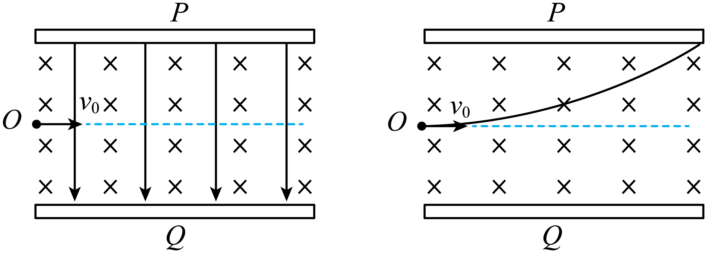

# Physics - 题目 857

**ID**: b49395d259f34600a58fcc80bbff7ce0
**年级**: Grade 11
**难度**: Medium
**题型**: Calculation

## 题目
如图甲所示，水平放置的两平行金属板P、Q之间有相互垂直的匀强电场和匀强磁场，电场强度大小为 $E$ 、方向竖直向下，磁场方向垂直纸面向里。​​​​​​​‌有一带正电的粒子以速度 $v{{}_{0}}$ 从两板左侧边缘的中点O沿水平方向射入到两板之间，恰好做匀速直线运动。已知两板长为 $3d$ ，两板间距为 $2d$ 。不计粒子所受重力以及平行板的边缘效应。（1）求磁感应强度 $B$ 的大小。（2）仅撤去电场，带电粒子仍以速度 $v{{}_{0}}$ 从O点沿水平方向射入磁场，恰好从P板的右边缘飞出，如图乙所示。已知 ${\sin}37{}^\circ =0.6$ ， ${\cos}37{}^\circ =0.8$ 。求：①带电粒子的比荷 $\frac {q}{m}$ ；②带电粒子在磁场中运动的时间 $t$ 。

## 解答

1. （1）一带正电的粒子以速度 $v{{}_{0}}$ 从两板左侧边缘的中点O沿水平方向射入到两板之间，恰好做匀速直线运动，根据受力平衡可知
2. $qv{{}_{0}}B=qE$
3. 解得磁感应强度的大小为
4. $B=\frac {E}{v{{}_{0}}}$
5. （2）①粒子在磁场中做匀速圆周运动，如图所示
6. 
7. 由图中几何关系可得
8. $r{^{2}}=(3d){^{2}}+(r-d){^{2}}$
9. 解得
10. $r=5d$
11. 由洛伦兹力提供向心力可得
12. $qvB=m\frac {v{{}_{0}^{2}}}{r}$
13. 联立解得带电粒子的比荷为
14. $\frac {q}{m}=\frac {v{{}_{0}}}{rB}=\frac {v{{}_{0}}}{5d\cdot \frac {E}{v{{}_{0}}}}=\frac {v{{}_{0}^{2}}}{5dE}$
15. ②设带电粒子在磁场中做匀速圆周运动轨迹对应的圆心角为 $θ$ ，则有
16. ${\sin}θ=\frac {3d}{r}=\frac {3}{5}$
17. 可得
18. $θ=37{}^\circ $
19. 则带电粒子在磁场中运动的时间为
20. $t=\frac {37{}^\circ }{360{}^\circ }T=\frac {37{}^\circ }{360{}^\circ }\cdot \frac {2πr}{v{{}_{0}}}=\frac {37πd}{36v{{}_{0}}}$

## 知识点

**中文**:
  - 带电粒子在叠加场中的运动
  - 带电粒子在有界磁场中运动的临界极值问题

**English**:
  - Motion in Superimposed Fields
  - Critical Extremum Problems in Bounded Magnetic Fields

---
