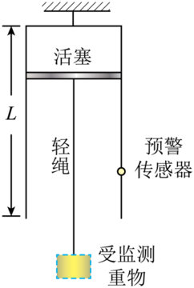

# Physics - 题目 1526

**ID**: ba6ecddc00a448e78a748db37b4a45ae
**年级**: Grade 11
**难度**: Medium
**题型**: Calculation

## 题目
如图所示为一超重报警装置示意图，高为L、横截面积为S、质量为m、导热性能良好的薄壁容器竖直倒置悬挂，容器内有一厚度不计、质量为m的活塞，稳定时正好封闭一段长度为 $\frac {L}{4}$ 的理想气柱。​​​​​​​‌活塞可通过轻绳连接受监测重物，当活塞下降至位于离容器底部 $\frac {3L}{4}$ 位置的预警传感器处时，系统可发出超重预警。已知初始时环境热力学温度为 $T{{}_{0}}$ ，大气压强为 $p{{}_{0}}$ ，重力加速度为g，不计摩擦阻力。（1）求轻绳未连重物时封闭气体的压强；（2）求刚好触发超重预警时所挂重物的质量M；（3）在（2）条件下，若外界温度缓慢降低1%，气体内能减少 $ΔU{{}_{0}}$ ，求气体向外界放出的热量Q。

## 解答

1. （1）轻绳未连重物时对活塞受力分析得 $p{{}_{1}}S+mg=p{{}_{0}}S$ ，解得 $p{{}_{1}}=p{{}_{0}}-\frac {mg}{S}$
2. （2）刚好触发超重预警时，对活塞受力分析得 $p{{}_{2}}S+(M+m)g=p{{}_{0}}S$ ，由玻意耳定律得 $p{{}_{1}}\frac {LS}{4}=p{{}_{2}}\frac {3LS}{4}$ ，解得 $M=\frac {2p{{}_{0}}S}{3g}-\frac {2}{3}m$
3. （3）由盖-吕萨克定律得 $\frac {V{{}_{2}}}{T{{}_{0}}}=\frac {V{{}_{3}}}{0.99T{{}_{0}}}$ ，其中 $V{{}_{2}}=\frac {3LS}{4}$ ，解得 $V{{}_{3}}=0.99V{{}_{2}}$ ，则 $\Delta V=V{{}_{2}}-V{{}_{3}}=\frac {3}{400}LS$ ，此过程外界对气体做的功为 $W=p{{}_{2}}\Delta V$ ，由热力学第一定律有 $\Delta U{{}_{0}}=Q-W$ ，可知 $Q=\Delta U{{}_{0}}+\frac {p{{}_{0}}SL}{400}-\frac {mgL}{400}$

## 知识点

**中文**:
  - 气体的等压变化与盖—吕萨克定律
  - 气体等温变化与玻意耳定律
  - 热力学第一定律及其应用

**English**:
  - Isobaric Change and Gay-Lussac's Law
  - Isothermal Change and Boyle's Law
  - First Law of Thermodynamics and Applications

---
