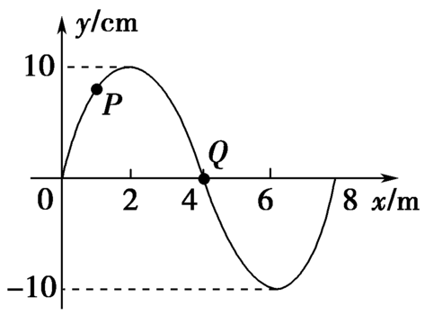

# Physics - 题目 1432

**ID**: bd94ad19640142e7b69f6c1d70376c3d
**年级**: Grade 11
**难度**: Medium
**题型**: Calculation

## 题目
一列简谐横波在t＝0时刻的波形如图所示，介质中质点P、Q分别位于x＝1m、x＝4m处。​​​​​​​‌从t＝0时刻开始计时，当t＝9s时质点P刚好第3次到达波峰。求：(1)在t＝9s时，Q点的位移；(2)该简谐横波传播的速度。

## 解答

1. (1)根据正弦函数变化的规律，该简谐波的波动方程是
2. $y=10{\sin}\frac {π}{4}x({\rm{c}}{\rm{m}})$
3. t=0时刻，质点P位于x=1m处，代入波动方程可得此时P点的位移是
4. $y{{}_{p}}=5\sqrt {2}{\rm{c}}{\rm{m}}$
5. 在t=9s时，P点到达波峰，相当于图示波形向左平移
6. $Δx=1{\rm{m}}$
7. 根据对称性，可知Q点的位移
8. $y{{}_{Q}}=-5\sqrt {2}{\rm{c}}{\rm{m}}$
9. (2)若波向右传播，则
10. $2\frac {7}{8}T{{}_{1}}=9{\rm{s}}$
11. $T{{}_{1}}=\frac {72}{23}{\rm{s}}$
12. $v{{}_{1}}=\frac {λ}{T}=\frac {23}{9}{\rm{m}}{\rm{/}}{\rm{s}}$
13. 若波向左传播，则
14. $2\frac {1}{8}T{{}_{2}}=9{\rm{s}}$
15. $T{{}_{2}}=\frac {72}{17}{\rm{s}}$
16. $v{{}_{2}}=\frac {λ}{T}=\frac {17}{9}{\rm{m}}{\rm{/}}{\rm{s}}$

## 知识点

**中文**:
  - 波的图像及其应用
  - 波长、频率和波速的关系及应用
  - 波的多解问题

**English**:
  - Wave Graphs and Applications
  - Relationship between Wavelength, Frequency, Wave Speed
  - Multi-solution Problems in Waves

---
