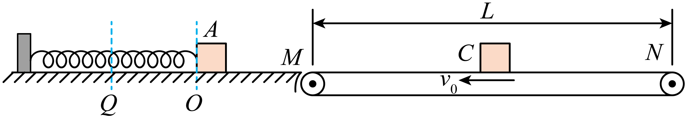

# Physics - 题目 444

**ID**: c464fca8e180417485b231794cce8f54
**年级**: Grade 11
**难度**: Medium
**题型**: Calculation

## 题目
如图所示，水平地面上有一轻质弹簧自然伸长，左端固定在墙面上，右端位于O点。​​​​​​​‌地面上M点右侧有一传送带，其上表面与地面齐平，传送带以 $v{{}_{0}}=6{\rm{m}}{\rm{/}}{\rm{s}}$ 的速度逆时针转动。现用力推动置于O点、质量 $m{{}_{{\rm{A}}}}=4{\rm{k}}{\rm{g}}$ 的小物块A，使弹簧缓慢压缩到Q点后由静止释放，物块A运动到O点时的速度 $v{{}_{{\rm{A}}}}=1{\rm{m}}{\rm{/}}{\rm{s}}$ 。现将物块A换成质量 $m{{}_{{\rm{B}}}}=1{\rm{k}}{\rm{g}}$ 的物块B，重复以上过程，发现物块B刚好运动到M点速度减为0，此时将质量 $m{{}_{{\rm{C}}}}=1{\rm{k}}{\rm{g}}$ 的物块C在传送带上与M距离为l（未知）的位置由静止释放，物块B、C碰撞后粘在一起，形成结合体P，P第一次到达O点时的速度大小为v（未知）。已知地面O点左侧光滑，物块B、C与传送带、O点右侧水平地面间的动摩擦因数均为 $μ=0.4{\rm ，\mathit{M}}$ 、N之间的距离 $L={{9}}{\rm{m}}$ ，重力加速度g取 $10{\rm{m}}{\rm{/}}{\rm{s}}{^{{{2}}}}$ ，物块A、B、C均可视为质点。（1）求O、M两点间的距离s；（2）若 $v=0$ ，求l的大小；（3）求v与l的关系表达式。

## 解答

1. （1）根据动能定理 $Fx{{}_{QO}}=\frac {1}{2}m{{}_{{\rm{A}}}}v{{}_{{\rm{A}}}^{2}}=\frac {1}{2}m{{}_{{\rm{B}}}}v{{}_{{\rm{B}}}^{2}}$ ，解得物块B运动到O点时的速度 $v{{}_{{\rm{B}}}}=2{\rm{m}}{\rm{/}}{\rm{s}}$ ，物块B、C在传送带、O点右侧水平地面间的加速度大小为 $a=μg=4{\rm{m}}{\rm{/}}{\rm{s}}{^{2}}$ ，物块B刚好运动到M点速度减为0，则 $v{{}_{{\rm{B}}}^{2}}=2as$ ，解得O、M两点间的距离为 $s=0.5{\rm{m}}$
2. （2）若 $v=0{\rm ，P}$ 从M点第一次到达O点时，则 $v{^{2}}-v{{}_{M1}^{2}}=-2as$ ，物块B、C碰撞动量守恒有 $m{{}_{{\rm{C}}}}v{{}_{{\rm{C}}1}}=(m{{}_{{\rm{B}}}}+m{{}_{{\rm{C}}}})v{{}_{M1}}$ ，在传送带上有 $v{{}_{{\rm{C}}1}^{2}}=2al$ ，解得 $l=2{\rm{m}}$
3. （3）由上述分析可知，当 $0⩽l<2{\rm{m}}$ 时，P不能到达O点，物块C离开传送带的速度恰好为 $6{\rm{m}}{\rm{/}}{\rm{s}}$ 时，物块C在传送带上运动的距离为 $l{{}_{1}}=\frac {v{{}_{0}^{2}}}{2a}=4.5{\rm{m}}$ ，则当 $4.5{\rm{m}}⩽l⩽9{\rm{m}}$ 时，物块C离开传送带的速度为 $6{\rm{m}}{\rm{/}}{\rm{s}}$ ，则 $m{{}_{{\rm{C}}}}v{{}_{{\rm{C}}{{2}}}}=(m{{}_{{\rm{B}}}}+m{{}_{{\rm{C}}}})v{{}_{M2}}$ ， $v{^{2}}-v{{}_{M2}^{2}}=-2as$ ，解得 $v=\sqrt {5}{\rm{m}}{\rm{/}}{\rm{s}}$ ，当 ${{2}}{\rm{m}}⩽l<4.5{\rm{m}}$ 时，物块C离开传送带的速度满足 $v{{}_{{\rm{C}}3}^{2}}=2al$ ，且 $m{{}_{{\rm{C}}}}v{{}_{{\rm{C}}{{3}}}}=(m{{}_{{\rm{B}}}}+m{{}_{{\rm{C}}}})v{{}_{M3}}$ ， $v{^{2}}-v{{}_{M3}^{2}}=-2as$ ，解得 $v=\sqrt {2l-4}({\rm{m}}{\rm{/}}{\rm{s}})$

## 知识点

**中文**:
  - 传送带模型
  - 求解非弹性碰撞问题

**English**:
  - Conveyor Belt Model
  - Solving Inelastic Collision Problems

---
