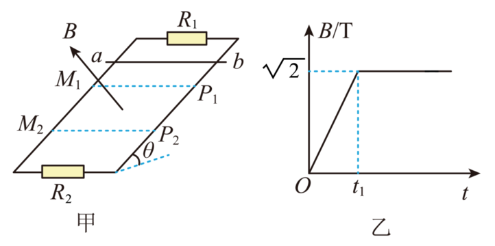

# Physics - 题目 1527

**ID**: c8835eb6ba4f466a99535f0f87398b3e
**年级**: Grade 11
**难度**: Medium
**题型**: Calculation

## 题目
如图甲所示，两根完全相同的平行长直导轨固定，长直导轨构成的平面与水平面的夹角θ=30°，导轨上端、下端分别连接电阻 $R{{}_{1}}$ 、 $R{{}_{2}}$ ，在导轨所在斜面的矩形区域 $M{{}_{1}}P{{}_{1}}P{{}_{2}}M{{}_{2}}$ 内分布有垂直斜面向上的磁场，磁感应强度大小随时间变化的规律如图乙所示。​​​​​​​‌t=0时刻在导轨斜面上 $M{{}_{1}}P{{}_{1}}$ 上方x=2.25 m处由静止释放金属棒ab，金属棒恰好匀速通过整个磁场区域。已知导轨间距L=1.0 m，磁场上边界 $M{{}_{1}}P{{}_{1}}$ 与下边界 $M{{}_{2}}P{{}_{2}}$ 间的距离d=4.5 m，金属棒与导轨接触的两点间的电阻r=4  ${\rm Ω，}R{{}_{1}}=R{{}_{2}}=4{\rm{\;}}Ω$ ，导轨电阻不计，金属棒与导轨间的动摩擦因数 $μ=\frac {\sqrt {3}}{5}$ ，取重力加速度大小 $g=10{\rm{\;}}{\rm{m}}/{\rm{s}}{^{2}}$ ，不计空气阻力，金属棒到达磁场下边界 $M{{}_{2}}P{{}_{2}}$ 前电路中一直有感应电流。求：（1）金属棒的质量m；（2） $0\sim t{{}_{1}}$ 时间内通过电阻 $R{{}_{1}}$ 的电荷量 $q{{}_{1}}$ ；（3）从金属棒被释放到金属棒到达磁场下边界 $M{{}_{2}}P{{}_{2}}$ 的过程中，电阻 $R{{}_{2}}$ 产生的焦耳热Q。

## 解答

1. （1）金属棒进入磁场前匀加速下滑，设金属棒的加速度大小为a，根据牛顿第二定律有 $mg\sin θ-{\rm μm}g{\cos}θ=ma$ ，设金属棒进入磁场瞬间的速度大小为v，根据运动规律有 $v{^{2}}=2ax$ ，金属棒进入磁场后电路的总电阻 $R{{}_{总}}=r+\frac {R{{}_{1}}R{{}_{2}}}{R{{}_{1}}+R{{}_{2}}}$ ，金属棒进入磁场后，回路中的感应电流大小 $I=\frac {B{{}_{{\rm{m}}}}Lv}{R{{}_{总}}}$ ，金属棒进入磁场后，金属棒受到的安培力大小 $F{{}_{{\rm{A}}}}=BIL$ ，金属棒进入磁场后，对金属棒受力分析，根据受力平衡有 $mg\sin θ=f+F{{}_{{\rm{A}}}}$ ，解得，金属棒的质量为m=0.5kg。
2. （2） $0\sim t{{}_{1}}$ 时间内感生电动势 $E=\frac {B{{}_{{\rm{m}}}}Lx}{t{{}_{1}}}$ ，通过电阻 $R{{}_{2}}$ 的电流 $I^{′}=\frac {E}{R{{}_{2}}+\frac {R{{}_{1}}r}{R{{}_{1}}+r}}$ ，根据电路结构可知， $0\sim t{{}_{1}}$ 时间内通过电阻 $R{{}_{1}}$ 的电流 $I{{}_{1}}=\frac {1}{2}I^{′}$ ， $0\sim t{{}_{1}}$ 时间内通过电阻 $R{{}_{1}}$ 的电荷量 $q{{}_{1}}=I{{}_{1}}t{{}_{1}}$ ，解得 $q{{}_{1}}=\frac {3\sqrt {2}}{8}{\rm{C}}$ 。
3. （3）根据运动规律有 $v=a{t}_{1}$ ， $0\sim t{{}_{1}}$ 时间内，电阻 $R{{}_{2}}$ 产生的焦耳热 $Q{{}_{1}}=I^{′}{{^{2}}}R{{}_{2}}t{{}_{1}}$ ，金属棒匀速通过磁场区域的过程中，流过电阻 $R{{}_{2}}$ 的电流 $I{{}_{2}}=\frac {1}{2}I$ ，金属棒匀速通过磁场区域的过程中，电阻 $R{{}_{2}}$ 产生的焦耳热 $Q{{}_{2}}=I{{}_{2}}{^{2}}R{{}_{2}}\frac {d}{v}$ ，从金属棒被释放到金属棒到达磁场下边界 $M{{}_{2}}P{{}_{2}}$ 的过程中，电阻 $R{{}_{2}}$ 产生的焦耳热 $Q=Q{{}_{1}}+Q{{}_{2}}=3.75{\rm{J}}$ 。

## 知识点

**中文**:
  - 电磁感应现象中的功能问题

**English**:
  - Work-Energy Problems in EM Induction

---
