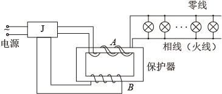

# Physics - 题目 1934

**ID**: d31378b72fe04605a4ae580ddc4ee051
**年级**: Grade 11
**难度**: Medium
**题型**: Calculation

## 题目
如图所示是一种触电保护器，变压器A处用双股相线（火线）和零线平行绕制成线圈，然后接到用电器上，B处有一个输出线圈，一旦有电流，经放大后便能立即推动继电器J切断电源，下列情况下能使保护器切断电源起保护作用的是哪一种？说明理由。​​​​​​​‌(1)增加开灯的盏数；(2)当有人双手分别接触相线（火线）和零线触电时；(3)当有人单手接触相线（火线），脚与地相接触而触电时。

## 解答

1. (1)不能。因A处线圈采用的是双线绕法，增加开灯的盏数只会使电路中电流增大，但A处两线中电流始终大小相等方向相反，线圈中磁通量相互抵消，B中磁通量始终为零，不发生改变。B中没有感应电流，故不能推动继电器J切断电源。
2. (2)不能，理由同(1)，因为双手分别接触相线和零线相当于将一个电阻并联接入电路。
3. (3)能。因为有电流通过人体而流入地下，使A处相线与零线的电流不同，从而使B中磁通量发生改变，B中产生感应电流，从而推动继电器J切断电源。

## 知识点

**中文**:
  - 自感现象的理解与分析

**English**:
  - Understanding and Analysis of Self-Induction

---
