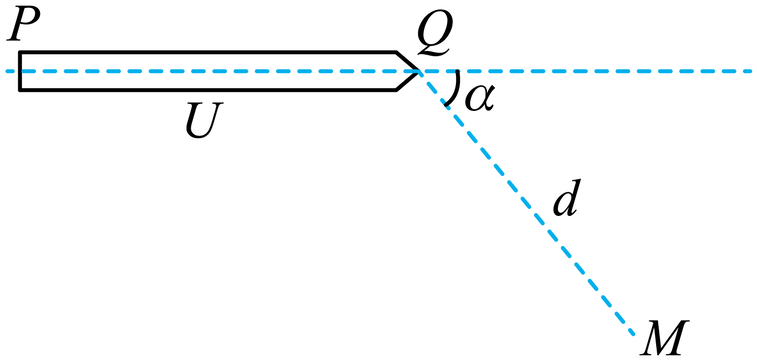

# Physics - 题目 81

**ID**: d39651c0e7464ff1bdd122c30fa34dd3
**年级**: Grade 11
**难度**: Medium
**题型**: Calculation

## 题目
在高能物理研究中，需要实现对微观粒子的精准控制。​​​​​​​‌如图所示，电子在管道PQ内匀强电场的作用下由P点从静止开始做匀加速直线运动，从Q点射出，电子最终击中与枪口相距d的点M。QM与直线PQ夹角为α，且P、Q、M三点均位于纸面内。已知电子的电荷量为 $-e$ （ $e>0$ ）、质量为m、PQ间距为d、电场强度为E。求：（1）电子从Q点射出时的速度大小v；（2）若仅在管道外部空间加入垂直于直线PQ的匀强电场 $E{{}_{1}}$ ，请确定 $E{{}_{1}}$ 的方向和大小；（3）若仅在管道外部空间加入与直线QM平行的匀强磁场，求磁感应强度的最小值B？

## 解答

1. （1）加速过程，根据动能定理 $eEd=\frac {1}{2}mv{^{2}}$
2. 解得
3. $v=\sqrt {\frac {2eEd}{m}}$
4. （2）匀强电场 $E{{}_{1}}$ 垂直于直线 $PQ$ ，则电子离开Q点后做类平抛运动，电场力垂直PQ向下，又电子带负电，则电场E_{1}方向垂直PQ向上（PQM平面），PQ方向做匀速直线运动，有 $vt{{}_{1}}=d{\cos}α$
5. 垂直PQ方向匀加速直线运动，有 $\frac {1}{2}at{^{2}}=d\sin α$
6. 根据牛顿第二定律 $a{{}_{1}}=\frac {eE{{}_{1}}}{m}$
7. 联立可得 $E{{}_{1}}=\frac {4E{\tan}α}{{\cos}α}$
8. （3）将速度沿着和垂直 $QM$ 方向分解 $v{{}_{\mathrm{/\mskip-4mu/}}}=v{\rm{c}}{\rm{o}}{\rm{s}}α$ ， $v{{}_{\bot }}=v{\rm{s}}{\rm{i}}{\rm{n}}α$
9. 垂直于 $QM$ 方向做圆周运动，有 $qv{{}_{\bot }}B=m\frac {v{{}_{\bot }^{2}}}{r}$
10. 运动周期 $T=\frac {2πr}{v{{}_{\bot }}}=\frac {2πm}{eB}$
11. 磁感应强度的最小值，则周期T取最大值，平行于 $QM$ 方向做勺速直线运动
12. $t=\frac {d}{v{{}_{\mathrm{/\mskip-4mu/}}}}=\frac {d}{v{\rm{c}}{\rm{o}}{\rm{s}}α}$
13. 分运动的时间相同，刚好为一个周期T，即 $t=T$
14. 联立解得 $B{~}=2π{\cos}α\sqrt {\frac {2mE}{ed}}$

## 知识点

**中文**:
  - 带电粒子在组合场中的运动

**English**:
  - Motion in Combined Fields

---
