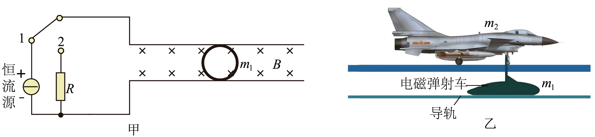

# Physics - 题目 2962

**ID**: e245ce45be464846bcd2fdc1363d9476
**年级**: Grade 11
**难度**: Medium
**题型**: Calculation

## 题目
福建舰配备了先进的电磁弹射系统。​​​​​​​‌某学习小组在研究电磁弹射时设计了如图甲所示的装置。两根固定于水平面内足够长的光滑平行金属导轨，间距 $d=0.2{\rm{m}}$ ，导轨区域内存在 $B=1{\rm{T}}$ 的竖直向下的匀强磁场。用质量 $m{{}_{1}}=40{\rm{g}}$ ，电阻为 $R{{}_{1}}=2{\rm{Ω}}$ 的匀质金属丝制成一个直径也为d的圆环作为电磁弹射车，圆环水平放在两条直导轨上和两导轨保持良好接触。实验时，将质量 $m{{}_{2}}=160{\rm{g}}$ 的绝缘模型飞机（如图乙）锁定在金属圆环上。计时开始，开关掷向1，与恒流源接通，干路电流恒为 $I=5{\rm{A}}$ 。金属环从静止开始推动模型飞机一起做匀加速运动，经过t时间后，模型飞机达到起飞速度 $v=10{\rm{m}}/{\rm{s}}$ 并立即与金属环解锁，飞离金属环。不计摩擦及一切空气阻力，不计导轨的电阻，不考虑圆环可能的形变。求：（1）求模型飞机的加速时间t。（2）若飞机起飞瞬间将开关立即掷向2，与 $R=2{\rm{Ω}}$ 的电阻接通，求此后电阻R上产生的焦耳热 $Q{{}_{{\rm{R}}}}$ 。（3）在第（2）问的情形中，飞机起飞后金属环运动的距离s。

## 解答

1. （1）对金属环和飞机模型整体进行分析，根据动量定理有 $BIdt=\left ({m{{}_{1}}+m{{}_{2}}}\right )v$
2. 解得 $t=2{\rm{s}}$
3. （2）金属环在导轨间两段圆弧并联接入电路中的等效电阻为 $r=\frac {R{{}_{1}}}{4}=0.5Ω$
4. 电路产生的总焦耳热为 $Q=\frac {1}{2}m{{}_{1}}v{^{2}}=2{\rm{J}}$
5. R产生的焦耳热为 $Q{{}_{{\rm{R}}}}=\frac {R}{r+R}Q$
6. 解得 $Q{{}_{{\rm{R}}}}=1.6{\rm{J}}$
7. （3）飞机起飞后，金属环在安培力作用下减速运动直至停止过程，根据动量定理有 $-B{\overline{I}}dΔt=0-m{{}_{1}}v$
8. 其中 $q={\overline{I}}Δt$
9. 感应电动势的平均值 ${\overline{E}}=\frac {\Delta Φ}{\Delta t}=\frac {Bds}{\Delta t}$
10. 感应电流的平均值 ${\overline{I}}=\frac {{\overline{E}}}{R+r}$
11. 联立解得 $s=25{\rm{m}}$

## 知识点

**中文**:
  - 动量定理及其应用
  - 导体切割磁感线产生感应电动势（电流）的分析与计算
  - 电磁感应现象中的功能问题

**English**:
  - Applications of Impulse-Momentum Theorem
  - Analysis and Calculation of Cutting Magnetic Field Lines
  - Work-Energy Problems in EM Induction

---
