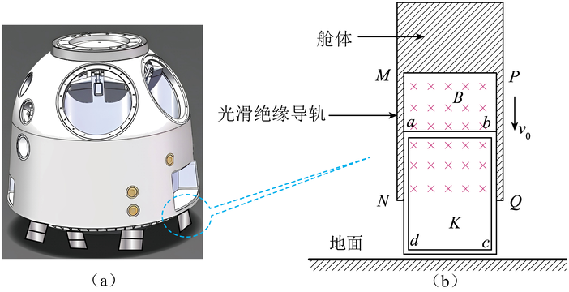

# Physics - 题目 184

**ID**: fae01eafacdd4258986ee0dd8c2efd3c
**年级**: Grade 11
**难度**: Medium
**题型**: Calculation

## 题目
为了确保载人飞船返回舱安全着陆，设计师在返回舱的底部安装了4台完全相同的电磁缓冲装置，如图（a）所示，图（b）为其中一台电磁缓冲装置的结构简图。​​​​​​​‌舱体沿竖直方向固定着两光滑绝缘导轨MN、PQ，导轨内侧安装电磁铁（图中未画出），能产生垂直于导轨平面的匀强磁场，磁感应强度为B。导轨内的缓冲滑块K内部用绝缘材料填充，外侧绕有n匝闭合矩形线圈abcd，其总电阻为R，ab边长为L。着陆时电磁缓冲装置以速度v_{0}与地面碰撞后，滑块K立即停下，此后在线圈与轨道的磁场作用下使舱体减速，从而实现缓冲。导轨MN、PQ及线圈的ad和bc边足够长，返回舱质量为m（缓冲滑块K质量忽略不计），取重力加速度为g，一切摩擦阻力不计。求：（1）缓冲滑块K刚停止运动时，舱体的加速度a的大小；（2）舱体着陆时（即导轨MN、PQ刚触地前瞬时）的速度v的大小；（3）若舱体的速度从v_{0}减到v的过程中，舱体下落的高度为h，则该过程中每台电磁缓冲装置中产生的焦耳热Q。

## 解答

1. （1）缓冲滑块K刚停止运动时，单个闭合矩形线圈产生的感应电动势为
2. $E=nBLv{{}_{0}}$
3. 回路电流为
4. $I=\frac {E}{R}$
5. 返回舱所受单个闭合矩形线圈的安培力为
6. $F{{}_{安}}=nBIL$
7. 根据牛顿第二定律得
8. $4F{{}_{安}}-mg=ma$
9. 解得
10. $a=\frac {4n{^{2}}B{^{2}}L{^{2}}v{{}_{0}}}{mR}-g$
11. （2）返回舱向下做减速运动，受到向上的安培力和向下的重力，随着速度的减小，安培力减小，直到安培力减小到与重力大小相等时，速度最小，此后匀速运动，直至舱体着陆时速度大小为v，可得
12. $E^{′}=nBLv$ ， $I^{′}=\frac {E^{′}}{R}$ ， $F^{′}{{}_{安}}=nBI^{′}L$
13. 由平衡条件可知
14. $4F^{′}{{}_{安}}=mg$
15. 解得
16. $v=\frac {mgR}{4n{^{2}}B{^{2}}L{^{2}}}$
17. （3）由能量守恒
18. $mgh+\frac {1}{2}mv{{}_{0}^{2}}=\frac {1}{2}mv{^{2}}+4Q$
19. 解得
20. $Q=\frac {1}{8}m\left ({v{{}_{0}^{2}}-\frac {m{^{2}}g{^{2}}R{^{2}}}{16n{^{4}}B{^{4}}L{^{4}}}}\right )+\frac {mgh}{4}$

## 知识点

**中文**:
  - 导体切割磁感线产生感应电动势（电流）的分析与计算
  - 电磁感应现象中的功能问题

**English**:
  - Analysis and Calculation of Cutting Magnetic Field Lines
  - Work-Energy Problems in EM Induction

---
