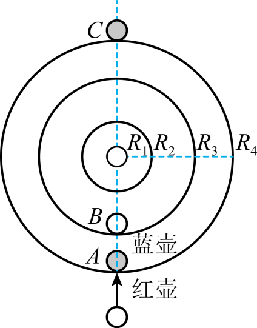

# Physics - 题目 2945

**ID**: 561b08e1dfd34672a0146ae9034bbf06
**年级**: Grade 11
**难度**: Medium
**题型**: 课时作业

## 题目
（多选）北京冬奥会中，冰壶是其中一个比赛大项。​​​​​​​‌某同学在观看比赛视频时发现蓝壶静止在大本营A处，红壶与蓝壶发生正碰，最终红壶运动 $2.7{\rm{s}}$ 停在B点，蓝壶运动 $5.4{\rm{s}}$ 停止在C点。通过查阅资料得知红、蓝壶质量均为 $20{\rm{k}}{\rm{g}}$ 、半径均为 $0.15{\rm{m}}$ ，大本营四个同心圆的半径分别为 $0.15{\rm{m}}、0.61{\rm{m}}、1.22{\rm{m}}、1.83{\rm{m}}$ ，重力加速度大小为 $10{\rm{m}}{\rm{/}}{\rm{s}}{^{{{2}}}}$ ，则下列说法正确的是（      ）

## 解答

1. AC．由题图可知，红壶碰后滑行的距离为 $x{{}_{1}}=R{{}_{4}}-R{{}_{3}}+2R{{}_{0}}=0.91{\rm{m}}$ ，蓝壶碰后滑行的距离为 $x{{}_{2}}=2R{{}_{4}}=3.66{\rm{m}}$ ，根据匀变速直线运动规律可得 $x{{}_{1}}=\frac {v{{}_{1}}}{2}t{{}_{1}}=\frac {1}{2}μ{{}_{1}}g\cdot t{{}_{1}^{2}}$ ， $x{{}_{2}}=\frac {v{{}_{2}}}{2}t{{}_{2}}=\frac {1}{2}μ{{}_{2}}g\cdot t{{}_{2}^{2}}$ ，联立解得 $v{{}_{1}}\approx 0.674{\rm{m}}{\rm{/}}{\rm{s}}$ ， $v{{}_{2}}\approx 1.356{\rm{m}}{\rm{/}}{\rm{s}}$ ， $μ{{}_{1}}=μ{{}_{2}}\approx 0.025{\rm ，A}$ 错误，C正确；
2. B．根据动量守恒定律有 $mv{{}_{0}}=mv{{}_{1}}+mv{{}_{2}}$ ，解得 $v{{}_{0}}=2.03{\rm{m}}{\rm{/}}{\rm{s}}{\rm ，B}$ 正确：
3. D．根据以上数据通过计算发现 $\frac {1}{2}mv{{}_{0}^{2}}>\frac {1}{2}mv{{}_{1}^{2}}+\frac {1}{2}mv{{}_{2}^{2}}$ ，系统机械能不守恒，D正确。选BCD。

## 知识点

**中文**:
  - 碰撞可能性判断

**English**:
  - Judgment of Collision Possibility

---
