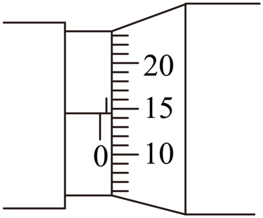
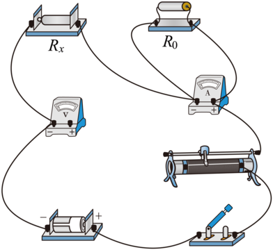

# Physics - 题目 1517

**ID**: 14adfa17eef047b58b5f1c03578d4098
**年级**: Grade 11
**难度**: Medium
**题型**: Experiment

## 题目
某物理实验小组利用实验室提供的器材测量一螺线管两接线柱之间金属丝的长度。​​​​​​​‌可选用的器材如下：待测螺线管 $L$ ；绕制螺线管的金属丝电阻率为ρ，阻值 $R$ 约为50Ω；电流表A_{1}；量程为1A，内阻 $r{{}_{1}}=40Ω$ ；电流表A_{2}：量程为500μA，内阻 $r{{}_{2}}=750Ω$ ；电压表V_{1}：量程为10V，内阻为10kΩ；电压表V_{2}：量程为3V，内阻约为1kΩ；定值电阻 $R{{}_{0}}=5Ω$ ；滑动变阻器 $R{{}_{3}}$ ,总阻值约为5Ω；电源E，电动势约为1.5V，内阻忽略不计；开关一个及导线若干。（1）实验中用螺旋测微器测得金属丝的直径如图所示，其示数D=mm；（2）为了尽可能准确地测量 $R{{}_{x}}$ ，且要求电表的指针偏转至少要达到满刻度的 $\frac {1}{3}$ ，根据要求电流表应选，电压表应选（以上两空均填器材代号）；（3）图是根据选用的实验器材连成的部分实物图，请在答题卷上将该实物图的连线补充完整；该实验在开关闭合前滑动变阻器的滑片应处于（选填“最左端”或“最右端”）；（4）若实验中电压表和电流表的示数分别为U、I，则金属丝的长度L=（用已知量的字母符号表示）。

## 解答

1. （1）螺旋测微器读数是固定刻度读数(0.5mm的整数倍)加可动刻度（0.5mm以下的小数）读数，图中读数为 $D=0.5{\rm{m}}{\rm{m}}+14.5\times 0.01{\rm{m}}{\rm{m}}=0.645{\rm{m}}{\rm{m}}$
2. （2）电源E，电动势约为1.5V，若仅待测电阻接入到电路中，电流大小为 $I{{}_{x}}=\frac {E}{R{{}_{x}}}=\frac {1.5}{50}{\rm{A}}={{0}}{{.}}{{0}}{{5}}{\rm{A}}$ ，要求电表的指针偏转至少要达到满刻度的 $\frac {1}{3}$ ，根据要求电流表应选A_{2}；电压表应选量程较小的电压表V_{2}；
3. （3）该实物图的连线补充完整如图
4. 
5. 滑动变阻器分压式连接，该实验在开关闭合前滑动变阻器的滑片应处于最左端；
6. （4）电流表改装后测得的待测电阻的电流为 $I^{′}=\frac {R{{}_{0}}+r{{}_{2}}}{R{{}_{0}}}I$ ，待测电阻的电压为 $U^{′}=U-Ir{{}_{2}}$ ，待测电阻的阻值为 $R=\frac {U^{′}}{I^{′}}=\frac {R{{}_{0}}\left ({U-Ir{{}_{2}}}\right )}{I\left ({R{{}_{0}}+r{{}_{2}}}\right )}$ ，根据电阻的决定式 $R=\frac {ρl}{S}$ ，得 $l=\frac {πD{^{2}}R{{}_{0}}\left ({U-Ir{{}_{2}}}\right )}{4ρI\left ({R{{}_{0}}+r{{}_{2}}}\right )}$ 。

## 知识点

**中文**:
  - 实验：导体电阻率的测量

**English**:
  - Experiment: Measuring Resistivity

---
