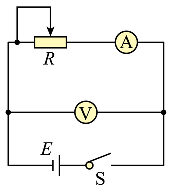

# Physics - 题目 711

**ID**: 295268fb687f4ea1aaa1fd9f3725eb34
**年级**: Grade 11
**难度**: Medium
**题型**: Experiment

## 题目
小明用如图所示的电路“测量电池的电动势和内电阻”．(1)备有如下器材​​​​​​​‌

## 解答

1. [1][2]由表中测量数据的范围知测量电流最大值小于0.6A，电流表选择0.6A量程的E即可，滑动变阻器的最大阻值一般比电池内阻大几倍就好了，取0～10Ω能很好地控制电路中的电流和电压，滑动变阻器选B；
2. [3][4]根据U−I图象可知，与U轴的交点表示电动势，所以
3. E＝1.5V，
4. 图线的斜率表示内阻，所以
5. $r=\frac {ΔU}{ΔI}{\rm{=}}\frac {1.50-0.90}{0.6}Ω{\rm{=}}1.0Ω$
6. [5]本实验中由于电压表的分流作用造成电流表读数总是比测量值小，造成
7. $E{{}_{测}}＜E{{}_{真}}$ ， $r{{}_{测}}＜r{{}_{真}}$

## 知识点

**中文**:
  - 实验：电池电动势和内阻的测量—伏安法测量电源电动势与内阻

**English**:
  - V-A Method for EMF and Internal Resistance

---
