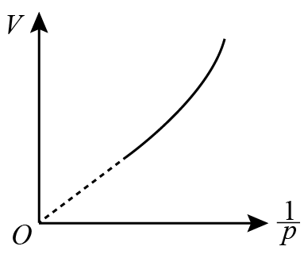

# Physics - 题目 362

**ID**: 3e4c9e63b22b4b19be9a400ec4822efe
**年级**: Grade 11
**难度**: Medium
**题型**: Experiment

## 题目
在“用DIS研究在温度不变时，一定质量的气体压强与体积的关系”实验中，某同学最后得到如图所示的V－ $\frac {1}{p}$ 图线（1）为了保持封闭气体的质量不变，实验中采取的主要措施是（2）若大气压强为p_{0}，注射器内气体初始体积为10cm^{3}，实验过程中，注射器内气体体积在4cm^{3}到20cm^{3}范围内变化，则注射器内部与外界压强差的最大值为p_{0}（3）图线弯曲的可能原因是在V增大过程中(           )​​​​​​​‌

## 解答

1. (1)[1]为了保持封闭气体的质量不变，实验中采取的主要措施是在注射器活塞上涂润滑油，这样可以保持气密性；
2. (2)[2]注射器内气体初始体积为10cm^{3}，注射器内气体体积在4cm^{3}到20cm^{3}范围内变化，则最小体积为4cm^{3}，由玻意尔定律 $p{{}_{1}}V{{}_{1}}=p{{}_{2}}V{{}_{2}}$ ，求得 $p{{}_{2}}=2.5p{{}_{0}}$ ，所以注射器内部与外界压强差的最大值为 $Δp=p{{}_{2}}-p{{}_{0}}=1.5p{{}_{0}}$
3. (3)[3]A．注射器有异物不会影响图线的斜率，A错误；
4. B．连接软管中存在气体可以视为被封闭的气体总体积较大，不会影响斜率，B错误；
5. CD．注射器内气体温度升高，由理想气体状态方程有： $\frac {pV}{T}=C$ ，当T增大时，PV会增大，C正确，D错误。选C。

## 知识点

**中文**:
  - 实验：探究气体压强与体积的关系

**English**:
  - Experiment: Investigating Pressure vs Volume

---
