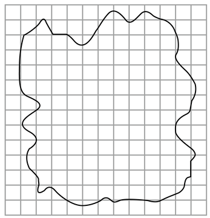

# Physics - 题目 1046

**ID**: 7a162188c38e4c2c8bce6af1704810e7
**年级**: Grade 11
**难度**: Medium
**题型**: Experiment

## 题目
在“用油膜法估测分子的大小”的实验中，所用油酸酒精溶液的浓度为每 $10{^{4}}{\rm{m}}{\rm{L}}$ 溶液中有纯油酸6mL，用注射器测得1mL上述溶液为75滴。​​​​​​​‌把1滴该溶液滴入盛水的浅盘里，待水面稳定后，将玻璃板放在浅盘上，用记号笔在玻璃板上描出油膜的轮廓，再把玻璃板放在坐标纸上，其形状和尺寸如图所示，坐标中正方形方格的边长为1cm。（1）油酸薄膜的面积是${\rm{c}}{\rm{m}}{^{2}}$ 。（2）每滴油酸酒精溶液中含有纯油酸的体积是mL。（计算结果保留一位有效数字）（3）按以上实验数据估测出油酸分子直径约为m。（计算结果保留一位有效数字）（4）如图是实验的部分操作步骤，操作步骤合理的顺序是；（填写字母即可）

## 解答

1. （1）由图可知，大于一半的算作一格，小于一半的格子舍掉，则油膜的面积大约有115格，则油酸薄膜的面积是115cm^{2}。
2. （2）每滴油酸酒精溶液中含有纯油酸的体积是 $V=\frac {6}{10{^{4}}}\times \frac {1}{75}{\rm{m}}{\rm{L}}{\rm{=}}{{8}}\times {{1}}{{0}}{^{-6}}{\rm{m}}{\rm{L}}$ 。
3. （3）估测出油酸分子直径约为 $d=\frac {V}{S}=\frac {8\times 10{^{-6}}}{115}{\rm{c}}{\rm{m}}=7\times 10{^{-10}}{\rm{m}}$ 。
4. （4）实验的操作步骤合理的顺序是先计算每滴油酸酒精溶液的体积，然后往水槽中撒入痱子粉，将溶液滴入液面后画出轮廓求解油膜面积，则合理顺序是CBDA。
5. （5）若某学生计算油酸分子直径的结果偏小，根据 $d=\frac {V}{S}$ ，则可能是：使用的油酸酒精溶液配制好后敞开放了很久，则浓度偏大，生成油膜的面积偏大，则油酸分子直径的计算结果偏小，A正确；求每滴溶液体积时，1mL的溶液的滴数少记了5滴，则计算时每滴溶液中含纯油酸的体积偏大，则油酸分子直径的测量值偏大，B错误；计算油膜面积时，舍去了所有不足一格的方格，则S测量值偏小，则油酸分子直径的测量值偏大，C错误。

## 知识点

**中文**:
  - 实验：用油膜法估测油酸分子的大小

**English**:
  - Experiment: Estimating Molecule Size using Oil Film Method

---
