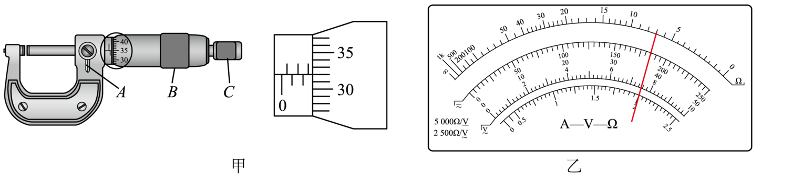
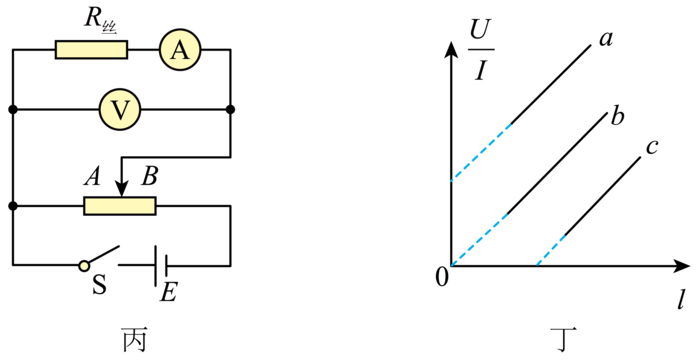

# Physics - 题目 1914

**ID**: 896e27f9118948c2a745027a341bd4b6
**年级**: Grade 11
**难度**: Medium
**题型**: Experiment

## 题目
某同学测量一段粗细均匀电阻丝的电阻率。​​​​​​​‌(1)用螺旋测微器测量电阻丝的直径。为防止读数时测微螺杆发生转动，读数前应先旋紧如图甲所示的部件（选填“ ${\rm A}$ ”“ ${\rm B}$ ”或“ ${\rm C}$ ”）。从图中的示数可读出电阻丝的直径为${\rm{m}}{\rm{m}}$ 。(2)用多用电表“ $\times 10$ ”倍率的欧姆挡测量该电阻丝的阻值，如图乙所示，示数为$Ω$ 。(3)将不同长度 $l$ 的电阻丝接入如图丙所示电路中，根据电压表示数 $U$ 和电流表示数 $I$ ，作出了 $\frac {U}{I}-l$ 图像，如图丁所示，若电流表的内阻不可忽略，符合实验结果的图线是（选填“ $a$ ”“ $b$ ”或“ $c$ ”）。

## 解答

1. （1）[1]为防止读数时测微螺杆发生转动，读数前应先旋紧如图甲所示的部件A；
2. [2]螺旋测微器的转动刻度50格共0.5mm长，精确度为0.01mm，格数要估读到0.1格，则电阻丝的直径为D=2.5mm+0.01×32.0mm=2.820mm
3. （2）欧姆表读电阻，由表盘上的数字乘以倍率得到阻值，可得示数为7×10Ω=70Ω
4. （3）根据欧姆定律 $U=I\left ({R{{}_{{\rm{A}}}}+R}\right )$
5. 根据电阻定律 $R=\frac {ρl}{S}$
6. 可得 $\frac {U}{I}=R{{}_{{\rm{A}}}}+\frac {ρ}{S}l$
7. 测量图线不过原点，而有纵截距；故选a图线；

## 知识点

**中文**:
  - 实验：导体电阻率的测量

**English**:
  - Experiment: Measuring Resistivity

---
