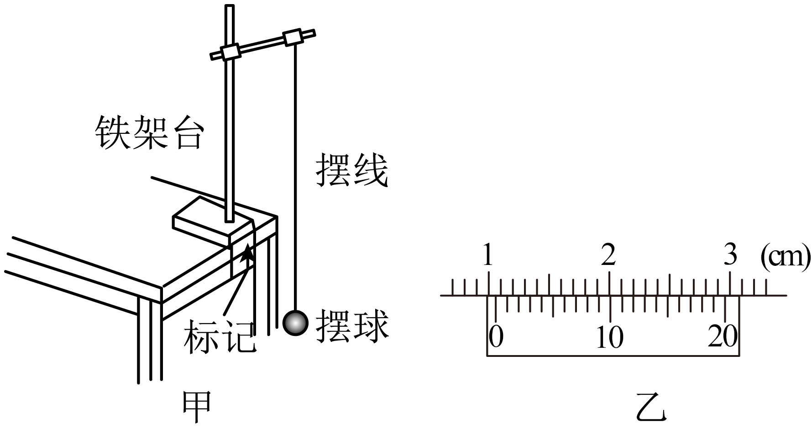

# Physics - 题目 454

**ID**: 9bc37d9f3d6e4fedb814b543e431d22a
**年级**: Grade 11
**难度**: Medium
**题型**: Experiment

## 题目
“争先”物理兴趣小组正在进行“用单摆测量重力加速度”的实验，同学们的实验装置如图甲所示。​​​​​​​‌(1)小组的李同学用游标卡尺测量摆球直径，读数如图乙所示，则摆球的直径为${\rm cm}$ 。(2)关于实验操作，下列说法正确的是。

## 解答

1. （1）摆球的直径
2. $d=1{\rm{c}}{\rm{m}}{{+}}{{1}}{{2}}\times {{0}}{{.}}{{0}}{{5}}{\rm{m}}{\rm{m}}=1.060{\rm{c}}{\rm{m}}$
3. （2）A．摆线要选择适当细些、长些、弹性差的细线。故A错误；
4. B．摆球尽量选择质量大些、体积小些的，能够减小阻力的影响。故B正确；
5. C．为了方便测量单摆的周期，摆角应不大于 $5{}\degree $ 。故C错误；
6. 故选B。
7. （3）设绳长为 $l$ ，摆球的直径为 $d$ ，周期为 $T$ ，则
8. $T=2π\sqrt {\frac {l+\frac {d}{2}}{g}}$
9. 整理上式可得
10. $g=\frac {4π{^{2}}\left ({l+\frac {d}{2}}\right )}{T{^{2}}}$
11. A．重力加速度与摆球的质量无关。故A错误；
12. B．若计数时误将41次记为40次，则由公式 $T=\frac {t}{n}$ 可知，周期偏大，则重力加速度偏小。故B错误；
13. C．单摆的摆角应不大于 $5{}\degree $ ，单摆的摆角仅为 $3.5{}\degree $ 。不会使重力加速度偏大。故C错误；
14. D．测摆长时，摆线拉得过紧，则 $l$ 偏大，重力加速度偏大。故D正确。
15. 故选D。
16. （4）由公式 $T=2{\rm{π}}\sqrt {\frac {l}{g}}$ 可得
17. $L=\frac {g}{4π{^{2}}}T{^{2}}$
18. 所以
19. $\frac {g}{4π{^{2}}}=k$
20. 解得
21. $g=4π{^{2}}k$

## 知识点

**中文**:
  - 实验：用单摆测量重力加速度

**English**:
  - Experiment: Measuring g with Simple Pendulum

---
