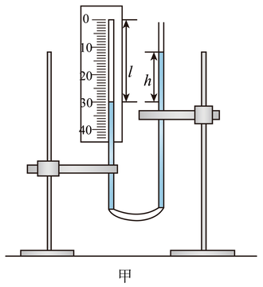
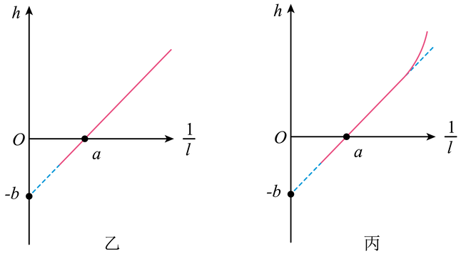

# Physics - 题目 1762

**ID**: b79fe468aeea4460bbba4c15c82163f9
**年级**: Grade 11
**难度**: Medium
**题型**: Experiment

## 题目
某小组探究一定质量的理想气体在温度不变时压强p与体积V的关系。​​​​​​​‌如图甲U形管两端是厚度不计、横截面积为S的细玻璃管，中间是软管。右管上端开口与大气相通，左管上端封闭且与刻度尺零刻度对齐，其内部用水银封闭一段理想气体。已知大气压强为p_{0}，水银的密度为ρ，重力加速度大小为g。（1）实验步骤如下：①竖直提升右管，使右侧水银面高于左侧，待稳定时，读出空气柱的长度l和U形管左右水银面的高度差h，此时封闭气体的压强p=；②竖直缓慢提升右管，并记录多组数据l和h；③处理数据，分析得出结论。（2）利用实验数据做 $h-\frac {1}{l}$ 图像如图乙所示，图像的横轴截距为a、纵轴截距为−b，则大气压p_{0}=；当封闭气体压强为p_{0}时，气体的体积为V=。（用ρ、g、S、a、b表示）（3）若发现图像的末端向上弯曲如图丙所示，其原因可能是环境温度（请填写“升高”或“降低”）。

## 解答

1. （1）根据压强的平衡关系可知 $p=p{{}_{0}}+ρgh$ 。
2. （2）气体温度不变，根据理想气体状态方程可得 $pSl=nRT$ ，解得 $h=\frac {nRT}{ρgS}\cdot \frac {1}{l}-\frac {p{{}_{0}}}{ρg}$ ，则有 $\frac {p{{}_{0}}}{ρg}=b$ ，大气压 $p{{}_{0}}=ρgb$ ，当封闭气体压强为p_{0}时，h=0，结合图像可知此时 $l=\frac {1}{a}$ ，气体体积为 $V=Sl=\frac {S}{a}$ 。
3. （3）若发现图像的末端向上弯曲，说明图像斜率变大，则 $k=\frac {nRT}{ρgS}$ 变大，则环境温度升高。

## 知识点

**中文**:
  - 实验：探究气体等温变化的规律

**English**:
  - Experiment: Investigating Isothermal Change (Boyle's Law)

---
