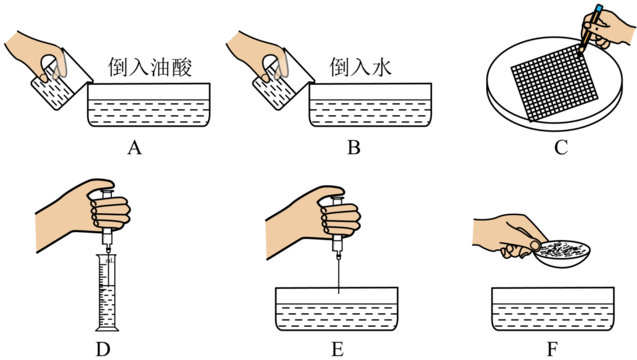
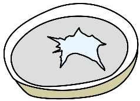

# Physics - 题目 120

**ID**: b8b1d3927ea64541a858e4484b9b7690
**年级**: Grade 11
**难度**: Medium
**题型**: Experiment

## 题目
某实验小组完成“用油膜法测油酸分子的大小”的实验。​​​​​​​‌（1）该小组进行下列实验操作，请选出需要的实验操作，并将它们按操作先后顺序排列：D（用字母符号表示）。（2）某次实验时，滴下油酸溶液后，痱子粉迅速散开形成如图所示的“锯齿”边沿图案，出现该图样的可能原因是；

## 解答

1. （1）“用油膜法测油酸分子的大小”的实验的实验步骤为：用注射器将事先配好的油酸酒精溶液一滴一滴地滴入量筒中，记下量筒内每增加一定体积时的滴数，由此计算出一滴油酸酒精溶液的体积；往边长约40cm的浅盘里倒入约2cm深的水，水面稳定后将适量痱子粉均匀撒在水面上；用注射器将事先配好的油酸酒精溶液滴一滴在水面上，待薄膜形状稳定；将玻璃板放在浅盘上，然后将油膜的形状用彩笔描绘在玻璃板上；将画有油膜形状的玻璃板平放在坐标纸上，计算出油膜的面积，根据油酸的体积和面积计算出油酸分子直径的大小。则排列顺序为DBFEC。
2. （2）出现该图样的可能原因是：痱子粉撒得太多，且厚度不均匀，导致油酸没有均匀排列开。

## 知识点

**中文**:
  - 实验：用油膜法估测油酸分子的大小

**English**:
  - Experiment: Estimating Molecule Size using Oil Film Method

---
