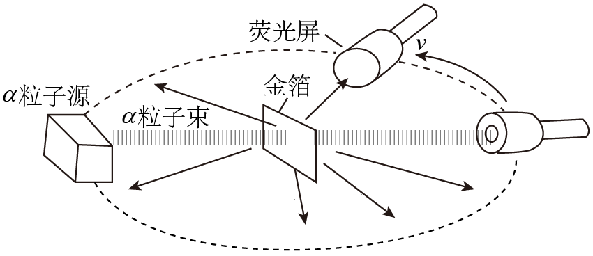

# Physics - 题目 2985

**ID**: b9febba6fc1e478a817bbe84c39e151b
**年级**: Grade 11
**难度**: Medium
**题型**: Experiment

## 题目
如图所示是英国物理学家卢瑟福用 ${\rm{α}}$ 粒子轰击金箱的实验装置示意图。​​​​​​​‌（1）下列关于该实验的描述正确的是。

## 解答

1. （1）[1] A． ${\rm{α}}$ 粒子轰击金箔的实验需要在真空条件下完成，避免 ${\rm{α}}$ 粒子和空气中的原子碰撞影响实验结果，A正确；
2. B． ${\rm{α}}$ 粒子的散射实验揭示了原子具有核式结构，B正确；
3. C．实验结果表明绝大多数 ${\rm{α}}$ 粒子穿过金箔后不发生偏转，只有极少数大角度的偏转，C错误；
4. D．该实验否定了汤姆生原子模型的正确性，D错误。选AB。
5. （2）[2] ABC． ${\rm{α}}$ 粒子散射实验说明占原子质量绝大部分的核是一个极小的核，并带有原子的全部正电，A错误BC正确；
6. D．卢瑟福发现了质子，查德威克发现了中子，D错误。选BC。
7. （3）[3]在 ${\rm{α}}$ 粒子的散射实验现象中，粒子所受原子核的作用力为斥力，指向轨迹弯曲的内测，大多数粒子都穿过金属箔，偏转很小，少数粒子发生角度很大的偏转，则ACD错误B正确。选B。

## 知识点

**中文**:
  - 实验：α粒子散射实验

**English**:
  - Experiment: Alpha Particle Scattering

---
