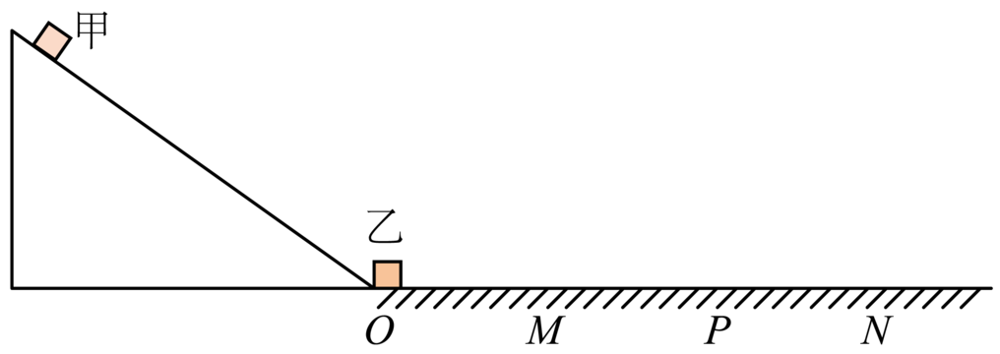

# Physics - 题目 2174

**ID**: bf04c46e29534c4aa1063a4c1a47e1a4
**年级**: Grade 11
**难度**: Medium
**题型**: Experiment

## 题目
某同学用斜轨道和水平轨道来验证动量守恒定律，如图所示，将斜轨道固定，并与水平轨道在O点由小圆弧平滑连接，将一物块甲由斜轨道上某一位置静止释放，物块甲最后停在水平轨道上，多次重复该操作，找到物块甲的平均停留位置，记为P点；将相同材质的物块乙放在O点，再次让物块甲由斜轨道上静止释放，多次重复该操作，找到物块甲、乙的平均停留位置，分别记为M、N点，回答下列问题。​​​​​​​‌（1）物块甲的质量应（选填“大于”“等于”或“小于”）物块乙的质量。（2）物块甲每次的释放位置应（选填“相同”或“不同”）。（3）若物块甲、乙的质量分别为 $m{{}_{1}}$、$m{{}_{2}}{\rm ，\mathit{O}}$ 点到P、M、N三点的距离分别为 $x{{}_{0}}$ 、 $x{{}_{1}}$ 、 $x{{}_{2}}$ ，若关系式成立（用 $m{{}_{1}}$、$m{{}_{2}}$、$x{{}_{0}}$ 、 $x{{}_{1}}$ 、 $x{{}_{2}}$ 表示），则说明该碰撞过程动量守恒；若关系式也成立（用 $x{{}_{0}}$ 、 $x{{}_{1}}$ 、 $x{{}_{2}}$ 表示），则说明该碰撞为弹性碰撞。

## 解答

1. （1）为保证碰撞过程不反弹，则甲的质量应大于乙的质量。
2. （2）为保证碰撞前甲的速度均相同，则甲每次应从同一位置释放。
3. （3） 物块在水平面上做匀减速运动，根据匀变速直线运动规律，则有 $v{^{2}}=2ax$ ，解得 $v=\sqrt {2ax}$ ，若碰撞过程动量守恒。则有 $m{{}_{1}}v{{}_{0}}=m{{}_{1}}v{{}_{1}}+m{{}_{2}}v{{}_{2}}$ ，即 $m{{}_{1}}\sqrt {x{{}_{0}}}=m{{}_{1}}\sqrt {x{{}_{1}}}+m{{}_{2}}\sqrt {x{{}_{2}}}$ ， 若为弹性碰撞，则有 $\frac {1}{2}m{{}_{1}}v{{}_{0}^{2}}=\frac {1}{2}m{{}_{1}}v{{}_{1}^{2}}+\frac {1}{2}m{{}_{2}}v{{}_{2}^{2}}$ ，联立可得 $\sqrt {x{{}_{0}}}+\sqrt {x{{}_{1}}}=\sqrt {x{{}_{2}}}$ 。

## 知识点

**中文**:
  - 实验：以动量守恒为基础的创新实验

**English**:
  - Innovative Experiments Based on Momentum Conservation

---
