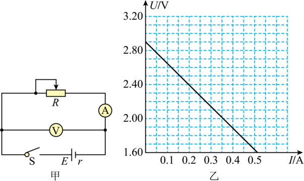

# Physics - 题目 2485

**ID**: cdacd9b1adbd4387ae2c4ef576809ccc
**年级**: Grade 11
**难度**: Medium
**题型**: Experiment

## 题目
在测电源电动势和内电阻”的实验中，有以下器材：待测干电池（电动势约为 $3{\rm{V}}$ ，内阻约为 $2.5Ω)$ ；电压表 ${\rm{V}}{{}_{1}}$ （量程 $0\sim 3.0{\rm{V}}$ ，内阻约为 $3{\rm{k}}Ω)$ ；电压表 ${\rm{V}}{{}_{2}}$ （量程 $0\sim 15{\rm{V}}$ ，内阻约为 $3{\rm{k}}Ω)$ ；电流表 ${\rm{A}}{{}_{1}}$ （量程 $0\sim 0.6{\rm{A}}$ ，内阻约为 $1.0Ω)$ ；电流表 ${\rm{A}}{{}_{2}}$ （量程 $0\sim 3.0{\rm{A}}$ ，内阻约为 $1.0Ω)$ ；滑动变阻器 $R{{}_{1}}$ （最大阻值 $10Ω$ ，额定电流 $2.0{\rm{A}})$滑动变阻器 $R{{}_{2}}$ （最大阻值 $100Ω$ ，额定电流 $0.1{\rm{A}})$(1)为了调节方便，测量精度更高，实验中电压表应选用（选填“ ${\rm{V}}{{}_{{{1}}}}$ ”或“ ${\rm{V}}{{}_{{{2}}}}$ ”），电流表应选用（选填“ ${\rm{A}}{{}_{1}}$ 或 ${\rm{A}}{{}_{{{2}}}}$ ”）滑动变阻器应选用（选填“ $R{{}_{1}}$ 或 $R{{}_{2}}$ ”）(2)在实验中使用如图甲电路进行测量，测得多组电压和电流值，得到如图乙所示的电压与电流关系图线，根据 $U-I$ 图线求出的电源电动势 $E=$${\rm{V}}$ ；内阻 $r=$$Ω$ 。​​​​​​​‌

## 解答

1. （1）[1][2][3]由题意可知，电源电动势约为3V，电源的内阻约为2. ${\rm 5}{\rm{Ω}}$ ，故为了易于调节，准确测量，电压表、电流表示数应超过 $\frac {1}{3}$ 量程，故选用V_{1}，A_{1}，滑动电阻器采用限流式接法，阻值与电阻内阻相差不大，故选用 $R{{}_{1}}$ ；
2. （2）[1][2]由闭合电路的欧姆定律 $U=E-Ir$
3. 由数学知识可得，图像与纵坐标的交点为电源的电动势，图像的斜率表示内电阻；故电动势 $E=2.90{\rm{V}}$
4. 电源内阻 $r=\frac {\Delta U}{\Delta I}=\frac {2.90-1.60}{0.5}\Omega =2.6\Omega $

## 知识点

**中文**:
  - 实验：电池电动势和内阻的测量—伏安法测量电源电动势与内阻

**English**:
  - V-A Method for EMF and Internal Resistance

---
