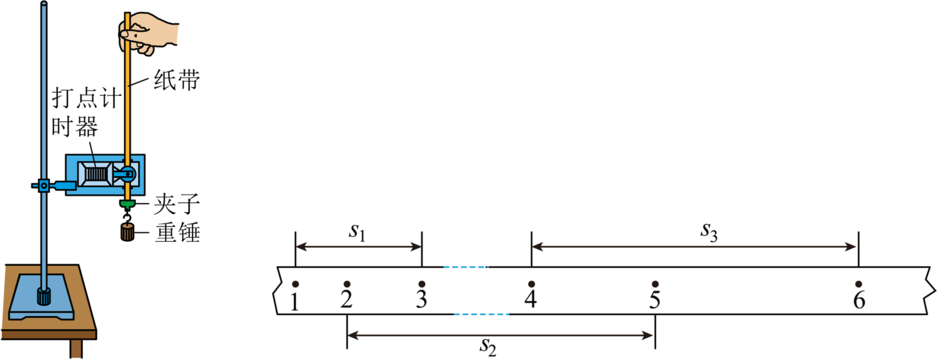

# Physics - 题目 2196

**ID**: e8920674a09541bba7e87252fa996715
**年级**: Grade 11
**难度**: Medium
**题型**: Experiment

## 题目
某同学用图所示实验装置测量当地的重力加速度。​​​​​​​‌让重锤做自由落体运动，选取打点计时器打出的纸带较清晰的一条如图所示来完成数据测量与处理。在纸带上取6个打点计时器所打的点，其中1、2、3点相邻，4、5、6点相邻，在3点和4点之间还有若干个点。打点计时器所用电源频率 $f=50{\rm{H}}{\rm{z}}{\rm ，\mathit{s}_{1}}$ 是l、3两点的距离，s_{3}是4、6两点的距离，s_{2}是2、5两点的距离。（1）求点2速度的表达式 $v{{}_{2}}=$；求重力加速度的表达式 $g=$（用s_{l}、s_{2}、s_{3}及f表示）。（2）该同学测得的数据 $s{{}_{1}}=3.10{\rm{c}}{\rm{m}}$ ，  $s{{}_{2}}=16.23{\rm{c}}{\rm{m}}$ ，  $s{{}_{3}}=7.73{\rm{c}}{\rm{m}}$ ，依公式可求得重力加速度 $g=$m/s^{2}（保留三位有效数字）。（3）测量值小于当地的重力加速度真实值的原因是。

## 解答

1. （1）[1]根据中点时刻的速度等于平均速度得点2速度为 $v{{}_{2}}=\frac {s{{}_{1}}}{2T}=\frac {fs{{}_{1}}}{2}$
2. [2]同理，根据中点时刻的速度等于平均速度得点5速度为 $v{{}_{5}}=\frac {fs{{}_{3}}}{2}$ ，根据匀加速直线运动位移速度公式可知 $2gs{{}_{2}}=v{{}_{5}}{^{2}}-v{{}_{2}}{^{2}}$ ，重力加速度的表达式 $g=\frac {{\rm{(}}s{{}_{3}^{2}}-s{{}_{1}^{2}}{\rm{)}}f{^{2}}}{8s{{}_{2}}}$
3. （2）[3]代入数据解得 $g=\frac {{\rm{(}}s{{}_{3}^{2}}-s{{}_{1}^{2}}{\rm{)}}f{^{2}}}{8s{{}_{2}}}=\frac {\left [{\left({7.73\times 10{^{-2}}}\right)^{2}}-{\left({3.10\times 10{^{-2}}}\right)^{2}}\right ]\times 50{^{2}}}{8\times 16.23\times 10{^{-2}}}=9.65{\rm{m}}{\rm{/}}{\rm{s}}{^{{{2}}}}$
4. （3）[4]测量值小于当地的重力加速度真实值的原因是重锤受空气阻力或打点过程中纸带受到阻力。

## 知识点

**中文**:
  - 自由落体相关实验

**English**:
  - Experiments Related to Free Fall

---
