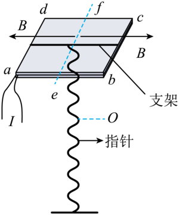

# Physics - 题目 1891

**ID**: ef24cc2b7be2418bb60b1a3cfbc3f8eb
**年级**: Grade 11
**难度**: Medium
**题型**: Experiment

## 题目
实验小组设计了一款简易电子秤，其主要结构如图，一根带有指针的轻弹簧下端固定，弹簧处于自由状态时指针指在O点，然后在弹簧上端固定带有支架的矩形线框abcd，线框中金属线圈匝数为 ${\rm \mathit{n}，}ad=bc=L$ ，静止时线框平面在水平面内，线框上再放上托盘 $($ 未画出 $)$ 。​​​​​​​‌以线框中心线ef为界，空间中，在ef左、右两侧分别加上水平向左、向右的匀强磁场，磁感应强度的大小均为B、方向垂直于ef，重力加速度大小为g。(1)给线圈通入电流，ab边受到的安培力大小为，要使指针重新指在O位置，从上往下看，给线圈通入电流的方向应为$($ 选填“顺时针”或“逆时针” $)$ 。(2)当线圈中通入大小为 $I{{}_{0}}$ 的电流时，指针重新指在O位置，则线框和托盘的总质量 $m{{}_{0}}=$$($ 用给出的物理量符号表示 $)$ 。(3)在第（2）问的条件下，在托盘上放入被称量物体，同时改变线圈中电流的大小，当电流大小为I时，指针重新指在O位置，则被称量物体的质量为$($ 用给出的物理量符号表示 $)$ 。

## 解答

1. （1）由于ab边与磁场方向平行，给线圈通入电流，ab边受到的安培力为零，由题意知，要使指针重新指在O位置，线框ad、bc边受到的安培力必须向上，根据左手定则可得从上往下看，给线圈通入电流的方向应为顺时针方向；
2. （2）由平衡条件有 $m{{}_{0}}g=2nBLI{{}_{0}}$
3. 解得 $m{{}_{0}}=\frac {2nBLI{{}_{0}}}{g}$
4. （3）由平衡条件有 $(m+m{{}_{0}})g=2nBLI$
5. 结合 $m{{}_{0}}g=2nBLI{{}_{0}}$
6. 解得 $m=\frac {2nBL(I-I{{}_{0}})}{g}$

## 知识点

**中文**:
  - 生活中的传感器

**English**:
  - Sensors in Daily Life

---
